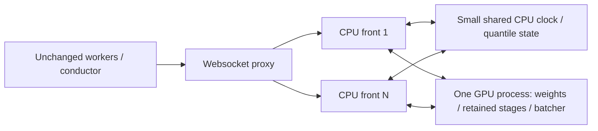

# CPU/GPU serving split

Design snapshot: 2026-10-08. Worktree: `openpi_decouple`, base `05a32800`.
No GPU measurements are claimed in this document.

## Existing paths

* `scripts/serve_policy.py::_serve_single` loads a complete π0.5 Policy and
  starts one BatchingCoordinator. Concurrent websocket connections get fresh
  `_wrap_policy` stacks. The interceptor keeps transforms and cache checks on
  the connection thread, submits unbatched inputs to stage 1, then GPU stage
  objects to stages 2/3. FULL_HIT omits stages 2/3. MISS carries its YAML k.
  Stage 2 contains a large DynamicCache; moving it to a CPU front is unsuitable.
* `websocket_policy_server.py` binds lazily at `select_bundle`,
  `episode_start`, or first infer. `load_cache_config` builds new shared storage
  and atomically replaces a bundle. Existing connections keep their wrapper
  snapshot, including the miss-step count. Episode controls reset state inside
  that wrapper. `replica_proxy.py` already routes connections and broadcasts
  YAML/normalizer controls across serving processes.
* `cache/orchestrator.py` collects stage fields, builds keys, retrieves,
  judges and broadcasts actions. Key builders pool/reduce on the original GPU
  tensors before producing CPU float32 keys. These reductions must remain on
  the GPU to preserve exact keys; replacing them with CPU pooling is unsafe.
* `closed_loop/serve_pi05.py` and `serve_groot.py` install `plugin.py` before
  loading models. Each connection clones the method's mutable containers,
  shares frozen fit arrays, and owns histories, retrieval/correction, gate
  decisions, blind state, policy tails and decision logs. Blind/policy-tail
  responses can skip the model completely. The plugin consumes CPU query keys.
* GR00T uses the island interpreter
  `/home/weiland/projects/openpi_ext/envs/gr00t_n15_venv/.venv/bin/python`,
  `third_party/gr00t_n15` and its `examples/Libero` on PYTHONPATH.
  `serve_groot_libero.py` loads Gr00tPolicy and wraps a GrootStagedRunner per
  connection. The ordinary cache path locks the entire infer. Stage 1 calls
  prepare_input, embeds images/text and scatters them; stage 2 runs the language
  backbone; stage 3 runs the upstream head or continuation. Trace mode alone
  already batches stage 3 through the JAX-free BatchingCore.
* R16's main-tree `resident.py` installs a registry of fitted PluginRuntimes
  selected by YAML id, interns frozen CPU arrays, and wraps the same connection
  factory. It still loads a full model per resident process. The split launcher
  can execute that entry point; resident routing stays in CPU fronts.

## Process ownership and transport

The opt-in launcher runs one weight-owning child and N independent front
interpreters. The parent and fronts never load weights. The original server
entry point constructs the model in the GPU child; an explicit child-only hook
replaces websocket listening with stage RPC. A CPU-only blueprint exports the
original transforms and metadata, never a model/module's parameters. Fronts
load the blueprint and retain the original websocket, cache and plugin code.

The plugin's server-wide connection IDs, blind decision clock and quantile
window remain shared across fronts. A small mmap file and process-safe RLock
preserve its existing short transaction boundaries; retrieval and GPU waits
never hold that lock. Synthetic winner tags remain stable. Per-front log
directories prevent collisions, including every R16 resident arm.

Each inference thread uses a private AF_UNIX channel and two bounded anonymous
memfd slots. SCM_RIGHTS transfers the descriptor once. Small msgpack envelopes
describe arrays; tensor/image bytes use mmap, with bf16 preserved as raw bytes.
Receivers copy before the producer can reuse a slot. There is no per-stage
array pickle. The blueprint/key-builder initialization uses cloudpickle once.

Stage handles are scoped to a channel and GPU-process epoch. GPU originals,
including KV and attention glue, stay in that process. Fronts receive host
views for CPU work and refer to originals for later stages and key reduction.
Every decision releases handles, including HITs and exceptions. EOF releases
the channel's handles. Admission, arena capacity, handle count and RPC timeout
are finite. A timeout closes its channel permanently; there is no automatic
retry of a possibly executed decision.

π0.5 reuses its existing stage batcher. GR00T uses BatchingCore for every model
stage, retaining B=1 image embedding kernels, shape-grouping backbone calls and
reusing its action-head batcher. GPU batch size defaults to one for equivalence
qualification. Larger widths are opt-in and require the coordinator's real GPU
parity run: bf16 reduction order can affect both keys and actions. Stubs can
prove transport/dispatch equivalence, but cannot bound hardware kernel drift.

The split currently qualifies write-frozen CP1 recipes, normal pool builders,
offline_search CPU retrieval/correction, k-step MISS and blind/policy tails.
GPU retrieval, camera completion/ablation, CP2, trace, warm-reset and compiled
vision are refused explicitly. They retain their existing entry points and
need separate equivalence coverage before their allowlist can be extended.
Online RIT feedback and stage-1/prefix overrides are also refused. The GR00T
live head K remains a process property, as in the existing serving path;
hot-loaded GR00T YAMLs must agree with that K. π0.5 K remains per bundle.

## Throughput model

For C CPU seconds per decision, D decisions per episode, hit fraction h and
GPU stage service demand G1 + (1-h)(G2+G3(k)), the upper bound is

`episodes/min <= 60 * min(N/(C*D), GPU batched decisions/s / D, worker episodes/s)`.

Model VRAM scales with GPU process count, not N. Host RAM and shared-memory
traffic scale with active channels, fit copies and stage views. A host view is
currently a full stage-1 sequence; pooled-key-only views are a future bandwidth
optimization, contingent on token-method requirements. The supervisor's raw
websocket forwarding also needs measurement at high N.

## Qualification

CPU-only stage tests use socketpairs and model-stage stubs, never websocket listeners.
Fresh-exec launcher checks additionally use private Unix IPC and model stubs
under >240-byte runtime parents. The stage address lives in a separate short
0700 XDG-runtime or `/tmp` directory; a 0600 `stage_endpoint.json` pointer links
it to the persistent run root. GPU bind, front connects and readiness share that
address, and owned teardown removes the socket directory. A copy of the pointer
stays in the split logs. Fronts can import GPU-created HF dynamic processor
classes before loading their CPU-only blueprint.
Recorded B-pool inputs feed method replay and profiling. The accompanying
handback records commands, measured CPU timings, failure behavior, supported
options and the GPU benchmark plan. GPU equivalence and throughput are tasks
for the coordinator; they have not been executed under this CPU-only request.
