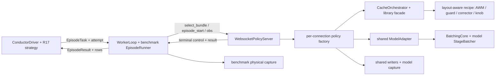

# R17 faithful framework integration design

**本文件是拟议实现规格；所有“新增/必须/应”都是后续工作要求，未表示代码已实现。** 已有事实在各段给出源码行证据，完整能力索引见 [INVENTORY.md](INVENTORY.md)。设计遵循 owner 要求：先正确接到现有 framework 的 policy、cache、serving、conductor seams，框架已经实现的机制直接复用，只补真正的 model / benchmark hooks。[OWNER_NOTE.md:3](/home/weiland/projects/openpi/exp/r17_integration/OWNER_NOTE.md:3)

第一条 end-to-end target：**现有 π0.5-RLinf-MT50 immutable checkpoint + 原 R17 formal MW 协议**，依次接入 default/full、两个不同 YAML bundles、retrieval、guard/corrector/periodic、episode conductor、debug，然后再接 GR00T-MW/Fast-WAM/DP。π-MW 已有模型变换与MW runner，可以先隔离 benchmark/framework 问题。[metaworld_policy.py:1](/home/weiland/projects/openpi/src/openpi/policies/metaworld_policy.py:1) [episode_runner.py:106](/home/weiland/projects/openpi/exp/metaworld/episode_runner.py:106) [RESULTS.md:3](/home/weiland/projects/openpi/exp/mw_finetune/RESULTS.md:3)

## 1. 保留框架路径，哪些能力自动得到



WS connection factory、bundle registry/lifecycle、cache pluggablecomponents、generic batch queues、conductor interfaces都已经存在；GR还有独立model adapter，这就是新模型应遵循的结构。[websocket_policy_server.py:600](/home/weiland/projects/openpi/src/openpi/serving/websocket_policy_server.py:600) [config.py:4384](/home/weiland/projects/openpi/src/openpi/cache/config.py:4384) [orchestrator.py:169](/home/weiland/projects/openpi/src/openpi/cache/orchestrator.py:169) [batching_core.py:221](/home/weiland/projects/openpi/src/openpi/serving/batching_core.py:221) [worker.py:44](/home/weiland/projects/openpi/src/openpi/conductor/worker.py:44) [staged.py:263](/home/weiland/projects/openpi/src/openpi/cache/groot/staged.py:263)

| 部分 | 接好 hook 后自动复用的 F 能力 | 必须补写 / 证书 |
|---|---|---|
| WS serving | connection isolation / control ack / episode lifecycle / timing envelope / registry / sameprocess concurrency | factory必须读取指定bundle而非latest；把wire转到model，传递生命周期；模型阶段/thread-safety；验证layout/identity。[websocket_policy_server.py:600](/home/weiland/projects/openpi/src/openpi/serving/websocket_policy_server.py:600) [websocket_policy_server.py:748](/home/weiland/projects/openpi/src/openpi/serving/websocket_policy_server.py:748) |
| Cache core | storage facade / backend / search / gate / judge plumbing / HIT-MISS分发信号 / frozen runtime policy | own KeyBuilder、stagedinterceptor、modelnormalization；R16 recipe需layout-aware bridge，旧PluginRuntime仅pi05/groot。[config.py:4384](/home/weiland/projects/openpi/src/openpi/cache/config.py:4384) [orchestrator.py:127](/home/weiland/projects/openpi/src/openpi/cache/orchestrator.py:127) [plugin.py:515](/home/weiland/projects/openpi/exp/offline_search/closed_loop/plugin.py:515) |
| Batch core | threequeues、wait/group/worker/metric/faultisolation、producer event API | model-specific `StageBatcher` bucket/stack/split/forwards/noise和alias证书；GR当前只S3。[batching_core.py:3](/home/weiland/projects/openpi/src/openpi/serving/batching_core.py:3) [batcher.py:291](/home/weiland/projects/openpi/src/openpi/cache/groot/batcher.py:291) |
| Replica/provisioning | stickyproxy + controlbroadcast/dumpaggregate；conductor多个endpoint | entrypoint启动计划、每island python、resourcebudget/metadata compatibility；π脚本replica supervisor不能直接load非π。[replica_proxy.py:1](/home/weiland/projects/openpi/src/openpi/serving/replica_proxy.py:1) [serve_policy.py:840](/home/weiland/projects/openpi/scripts/serve_policy.py:840) |
| Conductor | episode wire / WorkerLoop / errorretry / staleattemptfence / journal / stagehooks / agent supervision | benchmark runner / strategy / compatpredicate / persistentdispatch queue / census/protocol hash；R16driver内部硬编码LIBERO。[task.py:81](/home/weiland/projects/openpi/src/openpi/conductor/task.py:81) [scheduler.py:260](/home/weiland/projects/openpi/src/openpi/conductor/scheduler.py:260) [conductor.py:413](/home/weiland/projects/openpi/exp/offline_search/rounds/r16/conductor.py:413) |
| Debug/warmup/library | shared schema/writers/transport/pool/factors/store格式 | model capture、snapshot native schedule；benchmark physical state/entities；new geometry names与library-only fitting；现有collector/pool机制不要重写。[h5_sink.py:1](/home/weiland/projects/openpi/src/openpi/cache/trace/h5_sink.py:1) [warmup_pool.py:1](/home/weiland/projects/openpi/src/openpi/cache/warmup_pool.py:1) [build_in_memory_cache_artifact.py:90](/home/weiland/projects/openpi/exp/common/build_in_memory_cache_artifact.py:90) [adapter.py:61](/home/weiland/projects/openpi/exp/offline_search/debug/client/adapter.py:61) |

**一次调用的路径**：执行cursor允许已有tail则不运行任何stage；否则stage1取真实视觉key→`orchestrator.check(CP1,stage1=...)`。FULL_HIT用cache normalizedchunk；MISS继续同一个stage1的stage2和nativeK sampler；WARM_START只在adapter明确支持且payload证书通过时继续。所有结果经一次 `broadcast_action` / `clear`，一次动作逆变换返回wire；异常也清临时key，保留可审计失败。该次序沿现有GR分支和πinterceptor，不让 `infer(k)`重新做一次vision。[interceptor.py:449](/home/weiland/projects/openpi/src/openpi/cache/groot/interceptor.py:449) [interceptor.py:494](/home/weiland/projects/openpi/src/openpi/cache/groot/interceptor.py:494) [interceptor.py:554](/home/weiland/projects/openpi/src/openpi/cache/groot/interceptor.py:554) [interceptor.py:566](/home/weiland/projects/openpi/src/openpi/cache/groot/interceptor.py:566) [README.md:119](/home/weiland/projects/openpi/exp/offline_search/closed_loop/README.md:119)

## 2. 新代码位置与最小 shared 扩展

后续新增统一命名空间 `exp/r17_integration/` 下 `common/`、`models/{pi05,groot,fastwam,dp}/`、`benchmarks/`、`conductor/`、`debug/`、`search/`、`ops/`、`tests/`。本次只有设计文件/CPU检查材料；不会创建生产实现。

冻结边界：不改 `exp/offline_search/rounds/r16/`、R14/R15协议/fit、`harness/`。它们明确是旧维度和旧实验；只作reference/legacyparity。现有R17训练/serve/evaluate代码由其他owner维护，adapter导入其loader/变换，不热patch正在训练的模块。[README.md:3](/home/weiland/projects/openpi/exp/offline_search/harness/README.md:3) [dims.py:3](/home/weiland/projects/openpi/exp/offline_search/harness/dims.py:3) [ADAPTER.md:3](/home/weiland/projects/openpi/exp/offline_search/rounds/r16/ADAPTER.md:3) [CONTRACT.md:21](/home/weiland/projects/openpi/exp/mw_finetune/CONTRACT.md:21)

**P1拥有的 shared改动建议**（后续实现，默认off，逐项legacytests；其他包只提交hook给P1）：

| 文件 / 原 seam | 最小新增 seam | 原有路径保持条件 |
|---|---|---|
| `src/openpi/cache/config.py`：CacheConfig / validate / `_build_key_builder` / build_shared_storage / build_per_connection_components | optional `adapter_binding=None`；显式注册的 `AdapterProvider`，提供 validated key-builder factory、artifact identity/layout check、sampler descriptor/validator、trace capabilitycheck。新增builder名字逐个注册；canonicalstockbackend/search/judge构建仍由原factory处理 | 未指定binding时进入原代码；unknownbinding/typo/capability不匹配failfast，不能默认为π、不能忽略未知YAML字段。[config.py:890](/home/weiland/projects/openpi/src/openpi/cache/config.py:890) [config.py:1330](/home/weiland/projects/openpi/src/openpi/cache/config.py:1330) [config.py:4384](/home/weiland/projects/openpi/src/openpi/cache/config.py:4384) [config.py:4646](/home/weiland/projects/openpi/src/openpi/cache/config.py:4646) |
| `src/openpi/cache/types.py`：schedule registry | 新native schedule provider接口，旧 `DenoiseSchedule` / pi05_v1 / groot_n15完全保留；binding指定新sampler时才调用新provider | Fast shiftedflow和DDPM不能冒充旧uniformflow；schema和nativepoint归档见§7。[types.py:82](/home/weiland/projects/openpi/src/openpi/cache/types.py:82) [types.py:202](/home/weiland/projects/openpi/src/openpi/cache/types.py:202) |
| `src/openpi/cache/storage_types.py`：CachePayload | append-only optional `sampler_state`/`native_schedule_meta`（版本化，非任意pickle）；旧FULL_HIT只读取action_chunk，新WARM验证由provider执行，legacyvalidate原样 | 原 positional constructor / artifact读取不变；新sampler library必须显式binding，不默认把缺metadata读作pi05。[storage_types.py:61](/home/weiland/projects/openpi/src/openpi/cache/storage_types.py:61) [storage_types.py:105](/home/weiland/projects/openpi/src/openpi/cache/storage_types.py:105) [storage_types.py:122](/home/weiland/projects/openpi/src/openpi/cache/storage_types.py:122) |
| `src/openpi/serving/websocket_policy_server.py`：load_cache_config handler | optional `bundle_validator=None` 在注册前验证model/checkpoint/layout/benchmark/schedule；reuse现有load/storage/bundlelock/factory | 无validator路径保持原样；依赖上述config注册使新YAML沿现有ctrl路径加载，不另建控制server。[websocket_policy_server.py:782](/home/weiland/projects/openpi/src/openpi/serving/websocket_policy_server.py:782) [websocket_policy_server.py:827](/home/weiland/projects/openpi/src/openpi/serving/websocket_policy_server.py:827) |
| generic trace runtime / config binding（如确需） | 一个explicit model trace-provider registry，旧pi05/groot入口保持；modelID/layout/sampler metadata append-only | tracewriter/schema/队列共用；旧twins/arm名与closed_ok语义不改。[runtime.py:255](/home/weiland/projects/openpi/src/openpi/cache/trace/runtime.py:255) [runtime.py:336](/home/weiland/projects/openpi/src/openpi/cache/trace/runtime.py:336) [types.py:73](/home/weiland/projects/openpi/src/openpi/cache/trace/types.py:73) |

这组扩展应在一个shared包内review。`BatchingCore`已经adapter-driven，`replica_proxy`和conductorpure-data/worker core原则上**不需要模型特判或复制**。如果实现者发现必须改变它们，应先给一个失败的CPU接口test和最小additivehook，由P1落地。[batching_core.py:3](/home/weiland/projects/openpi/src/openpi/serving/batching_core.py:3) [replica_proxy.py:1](/home/weiland/projects/openpi/src/openpi/serving/replica_proxy.py:1) [task.py:3](/home/weiland/projects/openpi/src/openpi/conductor/task.py:3)

旧warm-reset/trace/CP2/routing组合限制保留，newmodel不能靠禁用validator来“支持”。R16entry的限制也不改；新R17entry支持经验证的组合，同时保留同样错误语义。[config.py:3705](/home/weiland/projects/openpi/src/openpi/cache/config.py:3705) [config.py:3858](/home/weiland/projects/openpi/src/openpi/cache/config.py:3858) [serve_groot.py:32](/home/weiland/projects/openpi/exp/offline_search/closed_loop/serve_groot.py:32)

## 3. ModelAdapter 合同（拟议v1，jax-free）

代码类型归P1；以下签名是各包实现时的稳定接口。B1对象拥有原生torch tensors，CPUcontracts定义不导入vendor/MuJoCo/JAX；GPUmodel只在显式load时导入，符合GR island不能import JAX的既有边界。[batching_core.py:25](/home/weiland/projects/openpi/src/openpi/serving/batching_core.py:25) [stage_io.py:29](/home/weiland/projects/openpi/src/openpi/serving/stage_io.py:29)

```python
@dataclass(frozen=True)
class ModelSpec:
    model_id: str                   # e.g. pi05_rlinf_mt50 / fastwam_libero
    checkpoint_identity: str       # composite immutable content digest
    norm_identity: str
    layout: ActionStateLayout
    feature_spec: FeatureSpec
    default_sampler: SamplerSpec
    capabilities: Capabilities

class ModelAdapter(Protocol):
    def metadata(self) -> ModelSpec: ...
    def prepare(self, wire_obs, request: RequestContext) -> PreparedObs: ...
    def run_stage1(self, prepared: PreparedObs) -> Stage1: ...
    def retrieval_fields(self, s1: Stage1) -> dict[str, Tensor]: ...
    def run_stage2(self, s1: Stage1, *, capture=False) -> Stage2: ...
    def sample(self, s2: Stage2, sampler: SamplerSpec,
               rng: RequestRNG, capture: CaptureSpec) -> SampleResult: ...
    def resume(self, s2: Stage2, snapshot: NativeSnapshot,
               sampler: SamplerSpec, rng: RequestRNG,
               capture: CaptureSpec) -> SampleResult: ...
    def to_wire(self, normalized_chunk: Tensor, prepared: PreparedObs) -> WireChunk: ...
    def extract_state_only(self, wire_obs) -> StateView: ...
    def make_stage_batcher(self) -> StageBatcher: ...
    def make_trace_adapter(self) -> ModelTraceAdapter: ...
    def cpu_blueprint(self) -> CPUModelBlueprint: ...  # optional split qualification
```

`full_call` 是统一conformance helper：`prepare→stage1→stage2→sample(default)→to_wire`；必须与已有unsplitwrapper sameobs/sameseed比较。`k_step_call(k)`只是改变native `SamplerSpec`，不是“完整infer之后截断动作”。`Stage1`保留MISS继续所需tensor；`retrieval_fields`输出namedCPU contiguous float32key，rawtensors保存为可选trace，不把整个GPUstate永久留在perconnection。旧KeyBuilder正是collect/build/clear并将key转CPU的模式。[key_builder.py:279](/home/weiland/projects/openpi/src/openpi/cache/components/key_builder.py:279) [key_builder.py:299](/home/weiland/projects/openpi/src/openpi/cache/components/key_builder.py:299) [interceptor.py:566](/home/weiland/projects/openpi/src/openpi/cache/groot/interceptor.py:566)

`SampleResult`至少含 normalized `(H,model_action_width)`、`actual_nfe`（真正forward次数）、native schedule/capture/rngreceipt；`WireChunk`是physical/nativecontroller `(H,valid_action_dim)`。原有π/GR可保留32channel存储，但 `layout.valid_action_mask`明确valid部分；Fast/DP无需为满足旧harness硬pad32。算法只能看active通道，尤其GRpadding是noise-like且会主导错误distance。[dims.py:3](/home/weiland/projects/openpi/exp/offline_search/harness/dims.py:3)

`ActionStateLayout` 必须给出 `horizon, replan_steps, valid_action_dim, valid_state_indices, motion_channels, gripper_channel, gripper_closed_convention, raw_state_fields, action_space_name, units, frame, output_transform_id`。LIBERO physical控制为7D，MW为4D；它们的control units不能简单因为值都在[-1,1]就宣称相同。元信息从现有wrapper/benchmark定义提取，并对未记录physicalscale标U。[main.py:309](/home/weiland/projects/openpi/examples/libero/main.py:309) [CONTRACT.md:35](/home/weiland/projects/openpi/exp/mw_finetune/CONTRACT.md:35) [conventions.py:6](/home/weiland/projects/openpi/exp/mw_finetune/groot/conventions.py:6)

`FeatureSpec`：policy-owned切点名称、真实camera列表、遮罩/缺省branch策略、token grid、hiddenwidth、pooling/version、prompt-dependent flag、key dtype、active state、policy/norm/preprocess digest。可启用现有stock键名 `vision_0/1/2,robot_state,prompt_emb,vlm_out`，其enabled名单必须与实际geometry一致；absentcamera不造fakekey，backenddim声明匹配builder返回字段。[config.py:1043](/home/weiland/projects/openpi/src/openpi/cache/config.py:1043) [build_in_memory_cache_artifact.py:107](/home/weiland/projects/openpi/exp/common/build_in_memory_cache_artifact.py:107)

`Capabilities`逐feature带 `supported / implemented_unverified / qualified / not_applicable`、原因、证据路径；coremandatory组：full/k-step、CP1retrieval、concurrent、bundle、episode、debugcapture、warmup/library、recipe、offline/replay、conductor、worker、analysis。高级组：nativewarmresume/reset、CP2、trace twins、shadow/routing、batchstage1/2/3、split。能力未实现不能通过acceptbundle；“not_applicable”只能用于数学/感知不存在的专项（如单相机的双cameraablation），不是遗漏核心支持的理由。既有debugschema已有available/not_applicable/unsupported/error的区分。[SCHEMA.md:9](/home/weiland/projects/openpi/exp/offline_search/debug/SCHEMA.md:9)

## 4. 四个模型沿原路径逐文件接入

### 4.1 π0.5-MetaWorld：第一条完整链路

| 步骤 | 现有路径 / 精确 seam | R17 新实现 |
|---|---|---|
| loader/config/norm | `scripts/serve_policy.py`policy加载与eagercompile选择；`training/config.py:pi05_metaworld`；`policies/metaworld_policy.py` | `models/pi05/adapter.py`使用现有trainconfig/immutablecheckpoint/normassets，禁止LIBERO transforms；加载前输出内容identity。[serve_policy.py:213](/home/weiland/projects/openpi/scripts/serve_policy.py:213) [config.py:836](/home/weiland/projects/openpi/src/openpi/training/config.py:836) [metaworld_policy.py:55](/home/weiland/projects/openpi/src/openpi/policies/metaworld_policy.py:55) |
| staged forward | `Policy`准备inputs，`PI0Pytorch.run_stage1/2/3` | 同一model与same preparedobs，不改网络；adapter保留32normalizedchannels、4activeaction/state；每requestgenerator明确。[policy.py:111](/home/weiland/projects/openpi/src/openpi/policies/policy.py:111) [pi0_pytorch.py:592](/home/weiland/projects/openpi/src/openpi/models_pytorch/pi0_pytorch.py:592) |
| CP1 key | `_CP1BaseKeyBuilder`fixedthreeblocks；actualbase真view、两个zero masked wrist | 新 `pi05_metaworld_cp1_spatial16_v1`仅vision_0、stateactive4；保留pool16算法32768；maskedslots不落library；prompt采样仍正确，不能错误截断prefix。[key_builder.py:159](/home/weiland/projects/openpi/src/openpi/cache/components/key_builder.py:159) [metaworld_policy.py:55](/home/weiland/projects/openpi/src/openpi/policies/metaworld_policy.py:55) |
| cachefactory / trace / batching | `scripts/serve_policy.py:_wrap_policy`、concurrentfactory、Pi05StageBatcher、InferenceInterceptor | `models/pi05/serve.py`为新campaign装配这些现有对象；newprovider补onecamera/identity/layout；共享WS原control路径；debugtap沿πhooks。[serve_policy.py:549](/home/weiland/projects/openpi/scripts/serve_policy.py:549) [serve_policy.py:1021](/home/weiland/projects/openpi/scripts/serve_policy.py:1021) [batching_coordinator.py:84](/home/weiland/projects/openpi/src/openpi/serving/batching_coordinator.py:84) [dispatch.py:22](/home/weiland/projects/openpi/exp/offline_search/debug/server/dispatch.py:22) |
| benchmarkworker | MW EpisodeRunner / LockedEnv / WorkerLoop | P2新workerentry/strategy，reuse原envkernel与renderer shim，补execution/debughooks，formal协议不变。[episode_runner.py:106](/home/weiland/projects/openpi/exp/metaworld/episode_runner.py:106) [env.py:105](/home/weiland/projects/openpi/exp/metaworld/env.py:105) [test_workers.py:18](/home/weiland/projects/openpi/exp/mw_finetune/tests/test_workers.py:18) |

π-MW的retrieval只使用真实base view，并不表示vision费用只有一次encoder：当前 `embed_prefix` 对每个image slot都执行 `embed_image`，之后才把mask放入attention；zero masked wrists仍有编码费用。初版沿原路径保持数值，Ckey测完整stage1；任何省掉maskedbranch的优化须独立parity/identity资格。[pi0_pytorch.py:358](/home/weiland/projects/openpi/src/openpi/models_pytorch/pi0_pytorch.py:358) [metaworld_policy.py:55](/home/weiland/projects/openpi/src/openpi/policies/metaworld_policy.py:55)

**H5的真实边界**：正式checkpoint H5、formalreplan5，每次本来已经用完chunk，没有可免费执行的第6–10步。因此 `commit_horizon=10` 必须配置阶段拒绝；不得重复chunk、越界补零、偷跑下一次infer后把它记成tail。先使full/k/retrieval/fivelayers/debug/conductor完整；commit功能本身应以layout感知controller提供，formalπ-MW `commit=5`，metadata写出能力上限。[config.py:836](/home/weiland/projects/openpi/src/openpi/training/config.py:836) [CONTRACT.md:104](/home/weiland/projects/openpi/exp/mw_finetune/CONTRACT.md:104) [plugin.py:131](/home/weiland/projects/openpi/exp/offline_search/closed_loop/plugin.py:131)

给owner可review的后续选项（可并行CPU研究，不需要中断第一目标）：

1. **保持原checkpoint，另建 `mw_commit_h5_replan1` protocol**：现有MWkernel接受1..5的replan，第一步query后允许最多剩余4步tail，最高commit5；与replan1 fullpolicy对比，独立benchmark/protocolID，不能与formalreplan5SR混报。[env.py:105](/home/weiland/projects/openpi/exp/metaworld/env.py:105)
2. **研究额外 `pi05_mt50_h10_candidate` identity**：源码按configH生成noise与suffix；是否该checkpoint可以H10严格load、是否preserve前5/quality尚未验证。先CPUshape/strictloadprobe，之后GPUfullbaseline+pairedquality资格；如失败保留H5限幅，不把H10视为已支持。[pi0_pytorch.py:469](/home/weiland/projects/openpi/src/openpi/models_pytorch/pi0_pytorch.py:469) [pi0_pytorch.py:680](/home/weiland/projects/openpi/src/openpi/models_pytorch/pi0_pytorch.py:680)

### 4.2 GR00T-MW：沿GR00T-LIBERO adapter，不重写Eagle/actionhead

1. loader复用 `exp/mw_finetune/groot/policy.py` / `data_config.py` / embodiment注册和metadata检查；shared原vendor `4af2b62`；`metaworld_sawyer`ID31、onevideo、state/action4、H16，默认K4。[policy.py:32](/home/weiland/projects/openpi/exp/mw_finetune/groot/policy.py:32) [conventions.py:6](/home/weiland/projects/openpi/exp/mw_finetune/groot/conventions.py:6) [HANDBACK_B.md:125](/home/weiland/projects/openpi/exp/mw_finetune/groot/HANDBACK_B.md:125)
2. 对同一backend.model创建 `GrootStagedRunner`，保留 `verify_upstream=True`、eval-mode/select-layer guards；one-cameraimage-tokenmask提供policy自身key。新 `GrootMetaWorldCP1SpatialPool16KeyBuilder`设置 `vision_fields=(vision_0,)`、state_mask前4，沿原basebuilder收集/transfer逻辑。不能直接用 `GrootLibero*`，它指定twocams；tokenrun是不是256必须实际stagefixture/后续GPU确认（代码假设256，MWcheckpoint的实测maskcount目前U）。[staged.py:284](/home/weiland/projects/openpi/src/openpi/cache/groot/staged.py:284) [key_builder.py:79](/home/weiland/projects/openpi/src/openpi/cache/groot/key_builder.py:79) [key_builder.py:152](/home/weiland/projects/openpi/src/openpi/cache/groot/key_builder.py:152) [key_builder.py:260](/home/weiland/projects/openpi/src/openpi/cache/groot/key_builder.py:260)
3. 复用 `GrootCacheInterceptor` 的 apply_transforms → staged → orchestrator → unapply_transforms；新 `models/groot/wire_policy.py`调用MW `to_groot_observation/from_groot_actions`，输出原4channel nativecontrols。LIBERO specialbuilder检查、LIBERO_wire/gripper不能从 `serve_groot_libero.py`照抄；只有factory架构/tracecoordinator/bundlelookup复用。[interceptor.py:449](/home/weiland/projects/openpi/src/openpi/cache/groot/interceptor.py:449) [interceptor.py:578](/home/weiland/projects/openpi/src/openpi/cache/groot/interceptor.py:578) [conventions.py:23](/home/weiland/projects/openpi/exp/mw_finetune/groot/conventions.py:23) [conventions.py:39](/home/weiland/projects/openpi/exp/mw_finetune/groot/conventions.py:39) [serve_groot_libero.py:200](/home/weiland/projects/openpi/exp/libero_groot/serve_groot_libero.py:200)
4. 新 `models/groot/serve.py`按原 `_build_concurrent_factory` 结构：process-sharedbackend/storage/coordinator；perconnectionrunner/keybuilder/orchestrator/wirepolicy；sameWS controls。H16允许commit10或15，真实executedcount验证。[serve_groot_libero.py:503](/home/weiland/projects/openpi/exp/libero_groot/serve_groot_libero.py:503) [serve_groot_libero.py:616](/home/weiland/projects/openpi/exp/libero_groot/serve_groot_libero.py:616) [plugin.py:1991](/home/weiland/projects/openpi/exp/offline_search/closed_loop/plugin.py:1991)
5. **K接入选用已证明形状**：初版像R16按K分process/endpoints，K4(default)/2/1，bundle的missK须等于livehead；热切method/YAML不热改共享headK。后续explicitlocalactionloop支持perrequestK时再新证书，不需每客户端锁修改globalhead属性。GRstage3batcher沿用原S3接口，S1/S2先走connectionthread/锁，不能假报已batch。[interceptor.py:248](/home/weiland/projects/openpi/src/openpi/cache/groot/interceptor.py:248) [batcher.py:299](/home/weiland/projects/openpi/src/openpi/cache/groot/batcher.py:299) [prepare.py:78](/home/weiland/projects/openpi/exp/offline_search/rounds/r16/prepare.py:78) [batcher.py:291](/home/weiland/projects/openpi/src/openpi/cache/groot/batcher.py:291)

### 4.3 Fast-WAM LIBERO + MW：新增 native staged runner

**已有实现切点**（localvendor为primarysource，不另假设论文特征）：`infer_action` normalizeimage/proprio、生成actionnoise、WanVAE cleanfirstframeencode、preparetext/proprio context、`video_expert.pre_dit`产生 `video_pre["tokens"]`，然后完整videoDiT `mot.prefill_video_cache`，最后K次actiondenoiser+FlowMatchScheduler.step。[modular.py:1810](/data/mw_finetune/vendor/lerobot/src/lerobot/policies/fastwam/wan/modular.py:1810) [modular.py:1825](/data/mw_finetune/vendor/lerobot/src/lerobot/policies/fastwam/wan/modular.py:1825) [modular.py:1860](/data/mw_finetune/vendor/lerobot/src/lerobot/policies/fastwam/wan/modular.py:1860) [modular.py:1879](/data/mw_finetune/vendor/lerobot/src/lerobot/policies/fastwam/wan/modular.py:1879)

| stage / 新文件 | 内容、key与cost设计 | 验证与约束 |
|---|---|---|
| `models/fastwam/loader.py` | MW复用C的strictbase+Wan+delta loader；LIBERO单独保留publishedbaseconfig与全action/propriohead、processors/stats | MWbuilder强制4D并resetaction/propriohead，绝不可给LIBERO使用；immutablecheckpointidentity包含base+Wan+delta+norm+tokenizer。[model.py:42](/home/weiland/projects/openpi/exp/mw_finetune/fastwam/model.py:42) [model.py:75](/home/weiland/projects/openpi/exp/mw_finetune/fastwam/model.py:75) [model.py:133](/home/weiland/projects/openpi/exp/mw_finetune/fastwam/model.py:133) |
| `staged.py:stage1` | pixelnorm/resize，realcamera图拼接，VAEfirstframe，`pre_dit(tokens/meta)`；policyownedkey为这个切点tokens做确定性spatialpool；text/proprio准备如原调用 | 不做video-prefill/noactiondenoise；poolgrid用meta，实测确认grid/layout，无原π16×16固定slice；无外部CLIP。其retrieval质量**待验证**。 |
| `key_builder.py` | MW onecamera；LIBERO左右twoimage拼图在nativeVAE/tokenizer上可能有边界混合，提供明确 `vision_0=fused_real_views` spec并记录原两viewmask；可研究per-viewsplit但不可声称bit-independent | publishedimage_size224×448；policy拼图顺序由 `_prepare_infer_image/_stack_video_from_images`确定；不要单独VAE每view改变原model。[config.json:47](/data/mw_finetune/models/fastwam_libero/config.json:47) [modeling_fastwam.py:401](/data/mw_finetune/vendor/lerobot/src/lerobot/policies/fastwam/modeling_fastwam.py:401) |
| `staged.py:stage2` | 只MISS执行完整video-prefill，保留KV和conditioning至stage3；FULL_HIT免prefill | 后prefillKV可作CP2研究key但比prekey贵且巨大，不复制全部KV进retrievallib；compiledKV需要clonebuffer。[modular.py:1860](/data/mw_finetune/vendor/lerobot/src/lerobot/policies/fastwam/wan/modular.py:1860) [modular.py:1870](/data/mw_finetune/vendor/lerobot/src/lerobot/policies/fastwam/wan/modular.py:1870) |
| `staged.py:stage3` | 使用同nativeactionnoise+完整shiftedflow timestep/delta grid，K1/2/default10；capture每步input/point/delta和NFE | CFG1，nativeH32；生成noise顺序和cpu RNG与原wrapper一致。[HANDBACK_C.md:67](/home/weiland/projects/openpi/exp/mw_finetune/fastwam/HANDBACK_C.md:67) [policy.py:38](/home/weiland/projects/openpi/exp/mw_finetune/fastwam/policy.py:38) [modular.py:1879](/data/mw_finetune/vendor/lerobot/src/lerobot/policies/fastwam/wan/modular.py:1879) |
| `wire_policy.py` | MW minmax inverse到4nativecontrols；LIBERO normalizer inverse后保持publishedtoggle | LIBERO toggle是 `sign(-(2*x-1))`，不等于GRgripper或普通linearstate；MW `toggle=[]`；动作只逆变换一次。[processor_fastwam.py:43](/data/mw_finetune/vendor/lerobot/src/lerobot/policies/fastwam/processor_fastwam.py:43) [processor_fastwam.py:108](/data/mw_finetune/vendor/lerobot/src/lerobot/policies/fastwam/processor_fastwam.py:108) [model.py:42](/home/weiland/projects/openpi/exp/mw_finetune/fastwam/model.py:42) |
| `batcher.py / serve.py / trace.py` | modelStageBatcher实现B1和B>1 bucketstack/split，singlemodelprocess同sharedcoreWS；trace可保存VAEtokens/prekey/KVsummary和x_t，不复用πstage_io | vendor infer返回 `[0]`单样本，必须新增保留B维的staged函数并测试，不通过forloop声称vectorbatch；切分KV/norm/noise不得互串。[modular.py:1902](/data/mw_finetune/vendor/lerobot/src/lerobot/policies/fastwam/wan/modular.py:1902) [batching_core.py:221](/home/weiland/projects/openpi/src/openpi/serving/batching_core.py:221) |

Fast-WAM LeRobot config默认K10，raw Wan `infer_action`函数默认却是K20；adapter每次都传显式config/nativeSampler K，不借rawdefault来定义LIBERO fullbaseline。[configuration_fastwam.py:216](/data/mw_finetune/vendor/lerobot/src/lerobot/policies/fastwam/configuration_fastwam.py:216) [modeling_fastwam.py:310](/data/mw_finetune/vendor/lerobot/src/lerobot/policies/fastwam/modeling_fastwam.py:310) [modular.py:1799](/data/mw_finetune/vendor/lerobot/src/lerobot/policies/fastwam/wan/modular.py:1799)

**key费用**：拟议 `Ckey = resize/pixelnorm + VAEfirstframe + pre_dit + declaredtext/propriocost + pool + D2H`；full还加video-prefill和K×actionhead。pre-DiT是模型自身trainedpatchprojection，但质量/cheap程度不能从“在prefill前”推导出毫秒或SR。C报告whole-callwarmup约0.48s不是Ckey，计价前按§10实测。[HANDBACK_C.md:103](/home/weiland/projects/openpi/exp/mw_finetune/fastwam/HANDBACK_C.md:103) [modular.py:1815](/data/mw_finetune/vendor/lerobot/src/lerobot/policies/fastwam/wan/modular.py:1815)

### 4.4 DP-T LIBERO + MW：新增condition/sample切分

1. `models/dp/loader.py`importE的strictloader/model/config/stats/languagecache；475tensors严格加载，reconstructedwrapper身份必须包含Ecode/release_recipe/feature_order。不能标成作者原实现。MW用最终immutableMT50checkpoint，ML45diagnostic不能当最终MW正式结果。[HANDBACK_E.md:13](/home/weiland/projects/openpi/exp/mw_finetune/dp/HANDBACK_E.md:13) [HANDBACK_E.md:139](/home/weiland/projects/openpi/exp/mw_finetune/dp/HANDBACK_E.md:139) [policy.py:21](/home/weiland/projects/openpi/exp/mw_finetune/dp/policy.py:21)
2. `staged.py:stage1`沿E `policy.py`做96resize/84crop、externalquantilenormalization、internalnormalizer、projectedCLIP语言；两FiLMResNet18 + SpatialSoftmax/Linear/ReLU构成policyown64vector/branch。主retrievalkey选择**exact post-ReLU64**；stage1保存每branchfeature并拼condition，MISS不能再调用完整 `condition(obs)`重复encoder。LIBERO两个realkeys64；MW只真实basekey64，zero-wristbranch仍进入policycondition，因为FiLM受language影响，不能称它无开销/constantzero。task/prompt可缓存该静态branch，但必须正确定价、prompt/contentidentity完全匹配。[model.py:25](/home/weiland/projects/openpi/exp/mw_finetune/dp/model.py:25) [model.py:40](/home/weiland/projects/openpi/exp/mw_finetune/dp/model.py:40) [model.py:77](/home/weiland/projects/openpi/exp/mw_finetune/dp/model.py:77) [model.py:141](/home/weiland/projects/openpi/exp/mw_finetune/dp/model.py:141) [policy.py:53](/home/weiland/projects/openpi/exp/mw_finetune/dp/policy.py:53)
3. `stage2`是cheapconditionassembly（身份stage，不伪造LLM），stage3沿E `sample` noise→transformer→scheduler.step。storage normalizedaction选择**internal-affine space**（scheduler输出trajectory），`to_wire`先internalunnormalize，再externalquantile inverse；E当前 `sample`已做internalinverse，newstaged函数从对应切点capture，不能重复inverse。normidentity包含两套统计及arrayhash。[model.py:90](/home/weiland/projects/openpi/exp/mw_finetune/dp/model.py:90) [model.py:154](/home/weiland/projects/openpi/exp/mw_finetune/dp/model.py:154) [policy.py:63](/home/weiland/projects/openpi/exp/mw_finetune/dp/policy.py:63) [RECIPE.md:60](/home/weiland/projects/openpi/exp/mw_finetune/dp/RECIPE.md:60)
4. default sampler=`ddpm100`；K1/2表示 `DDPMScheduler.set_timesteps(K)`得到新的grid并跑K次，不是前100step只跑1/2后就当clean。记录grid、beta/variance/prediction/clip/stepconfig。DDIM如需，显式 `sampler=ddim,K,eta` 新identity/newbaseline；CPU验证K100与原wrapper同seed；所有posteriornoise属于request RNG。[model.py:134](/home/weiland/projects/openpi/exp/mw_finetune/dp/model.py:134) [model.py:157](/home/weiland/projects/openpi/exp/mw_finetune/dp/model.py:157) [RECIPE.md:71](/home/weiland/projects/openpi/exp/mw_finetune/dp/RECIPE.md:71)
5. `batcher.py`按H16/actiondim/languagefeature/crop/scheduler/K bucket；scheduler每request/call构造，generator流不可被batch排序改变。DDPM posteriornoise应提前为每sample每step生成并传入等价update，或explicitper-sample调用scheduler.step进行CPU数学更新（GPUTransformer仍vectorbatch），先验证vsE本地单请求；不能把一个globalgenerator塞整个batch。[model.py:134](/home/weiland/projects/openpi/exp/mw_finetune/dp/model.py:134) [model.py:162](/home/weiland/projects/openpi/exp/mw_finetune/dp/model.py:162) [batching_core.py:221](/home/weiland/projects/openpi/src/openpi/serving/batching_core.py:221)
6. `trace.py`captureconditionfeatures、nativeinteger t、trajectory、prednoise、posteriornoise/rngreceipt、actionnorm/wire，same-noisefull/k与warmtwins使用matchednoise序列；K变更的timesteps不同，明确配对噪声规则。H16commit10/15需原executioncursor。现有LIBEROwrapper直接raw7command，不进行GRgripperconversion。[HANDBACK_E.md:49](/home/weiland/projects/openpi/exp/mw_finetune/dp/HANDBACK_E.md:49) [HANDBACK_E.md:228](/home/weiland/projects/openpi/exp/mw_finetune/dp/HANDBACK_E.md:228)

**DP Ckey**＝所有政策条件encoder（两FiLM分支，即使MW第二图zero）+languagecachelookup/uncachedcost+state/image transforms+D2H。Cfull加K次Transformer和posterior更新；没有π式LLMprefix价格。post-ReLU64和optionalpre-SpatialSoftmaxmap都可研究，但主spec先固定64，PCA最多min(64,rank)，只在library fit。[model.py:77](/home/weiland/projects/openpi/exp/mw_finetune/dp/model.py:77) [model.py:154](/home/weiland/projects/openpi/exp/mw_finetune/dp/model.py:154)

## 5. BenchmarkAdapter 合同与 LIBERO / MT50 映射

现有conductor `EpisodeTask.experiment`无固定benchmarksemantics，`EpisodeRunner.run`是可替换hook；MW已有实现，不另造scheduler。Septwarm-reset adapter用 `EntryEnv` / `BenchmarkAdapter`，不是源码里实际存在的名为EnvSpec的类。[task.py:1](/home/weiland/projects/openpi/src/openpi/conductor/task.py:1) [worker.py:44](/home/weiland/projects/openpi/src/openpi/conductor/worker.py:44) [warm_reset_env.py:124](/home/weiland/projects/openpi/exp/metaworld/warm_reset_env.py:124) [warm_reset_env.py:208](/home/weiland/projects/openpi/exp/metaworld/warm_reset_env.py:208)

拟议 `BenchmarkSpec`：benchmark/version/protocolID、orderedtasktable+prompttable+groupdigest、envpackage/assets/sourcehash、initdatahash、renderer/camera/captureconventions、settle/maxpolicycontrols/replan/success/terminations。`BenchmarkAdapter`提供 `tasks()/episode_specs()/make_env()/reset_settle()/to_policy_obs()/step()/success()/physical_capture()/worker_probe()/episode_runner()`。tasktable与protocolspec import时不importGPU或simulator；nativeenvironment放workerisland中lazyload。

| 字段 | LIBERO legacy / R16 | MetaWorld MT50 R17 v1 | 接入动作与证据 |
|---|---|---|---|
| tasks / suites / groups | genericrunner支持spatial/object/goal/10；R16只long/spatial，10task/suite | canonical50orderedv3tasks；easy28/medium11/hard6/very_hard5；suite=`metaworld_mt50`，difficulty是reportgroup，不是独立checkpoint | reuse `tasks.MT50_TASKS/PROMPTS/DIFFICULTY`，sealorder，别用排序后随意重编号。[main.py:136](/home/weiland/projects/openpi/examples/libero/main.py:136) [prepare.py:27](/home/weiland/projects/openpi/exp/offline_search/rounds/r16/prepare.py:27) [tasks.py:3](/home/weiland/projects/openpi/exp/metaworld/tasks.py:3) |
| task language | LIBEROtask.description | canonicalRLinfprompt；push-back与push共文本；训练checkpoint可能不同prompt | identity必须taskname而非promptalone；prompttablehash + permodelauthorized prompt profile；更换profile视为新baseline。[tasks.py:107](/home/weiland/projects/openpi/exp/metaworld/tasks.py:107) [HANDBACK_B.md:145](/home/weiland/projects/openpi/exp/mw_finetune/groot/HANDBACK_B.md:145) |
| init identity | officialinitstates index0..49；R16 A/B子集 + originalindex | MT1(task,seed7).train_tasks[idx]，idx0..49实际taskdata；正式evalidx0..9 | 存taskdata内容digest及envversion；不是随意`env.reset(seed=idx)`，不能把idx误作randomseed。[env.py:47](/home/weiland/projects/openpi/exp/metaworld/env.py:47) [env.py:56](/home/weiland/projects/openpi/exp/metaworld/env.py:56) [CONTRACT.md:104](/home/weiland/projects/openpi/exp/mw_finetune/CONTRACT.md:104) |
| seeds / RNG | R16protocolseed2026101401，env/initmanifest固定；其他LIBEROmaindefault7 | benchmarkseed7；modeldecisionnoise seedhash(mt50:7:task:idx:decision)，不含arm/worker/attempt | 保留A正确定义便于pairedarms；library/aug另独立namespace，sameacceptedidentity acrossrestart一致。[RUNBOOK_CONDUCTOR.md:7](/home/weiland/projects/openpi/exp/offline_search/rounds/r16/RUNBOOK_CONDUCTOR.md:7) [CONTRACT.md:55](/home/weiland/projects/openpi/exp/mw_finetune/CONTRACT.md:55) |
| observation | 2realcamera、state8；π224、GR256；images180° | onecorner2 RGB480，cameraID2位置(.75,.075,.7)，180°contiguous；rawfullstate用于debug，policy取first4 | worker保留原480exactpixels，由modeladapterresize一次；πmaskedwrists/DPzero-conditionedbranch仅model内部。[conductor.py:419](/home/weiland/projects/openpi/exp/offline_search/rounds/r16/conductor.py:419) [tasks.py:36](/home/weiland/projects/openpi/exp/metaworld/tasks.py:36) [env.py:72](/home/weiland/projects/openpi/exp/metaworld/env.py:72) [env.py:87](/home/weiland/projects/openpi/exp/metaworld/env.py:87) |
| nativeaction | 7controller dims，包括rotation与gripper | 4[x,y,z,gripper] nativeaction，env内部clips | benchmarkadapter不作LIBEROscaling/inversion；记录serverrequested和envappliedclip及perstepactualaction。[CONTRACT.md:35](/home/weiland/projects/openpi/exp/mw_finetune/CONTRACT.md:35) [env.py:105](/home/weiland/projects/openpi/exp/metaworld/env.py:105) |
| settle / policycap / replan | wait10，spatial220 / long520，replan5 | settle15，policycap160，replan5 | 不把settle加入policyNFE/controlcost；最后chunksuccess中途停止时写actualcontrols。[RUNBOOK_CONDUCTOR.md:7](/home/weiland/projects/openpi/exp/offline_search/rounds/r16/RUNBOOK_CONDUCTOR.md:7) [tasks.py:31](/home/weiland/projects/openpi/exp/metaworld/tasks.py:31) [env.py:96](/home/weiland/projects/openpi/exp/metaworld/env.py:96) |
| success / termination | LIBEROdone表示成功，由runnerrecord | info.success任一步True；terminated/truncated无success是正常failure，异常是error | success不从reward值猜；全链episode_end与result一致；errorsmissing不计SRfalse。[env.py:143](/home/weiland/projects/openpi/exp/metaworld/env.py:143) [CONTRACT.md:111](/home/weiland/projects/openpi/exp/mw_finetune/CONTRACT.md:111) |
| identity / retry | yaml:phase:task:init + attempt;oldglobalepisodeid按trials映射 | 新manifest含benchmark/protocol/model/norm/layout/fit/YAMLhash，UIDnamespace在yaml_id内，task/initoriginalindex保留 | reusemake_task_uid，不改coreUIDparser；`yaml_id=r17_<campaign-digest>_<arm>`避免不同MW与LIBERO同taskID碰撞；extra带specdigest和requestsequence。[task.py:66](/home/weiland/projects/openpi/src/openpi/conductor/task.py:66) [task.py:81](/home/weiland/projects/openpi/src/openpi/conductor/task.py:81) |
| workerlane / renderer | R16timan107旧3.8payload64workers | wls→timan107 / h100→timan108，A3.11.15sim/MW3.0/MuJoCo3.14，first-render/closeglobalEGLlock，start12cap30 | 不拷checkpoint到timan；probe attestGL_VENDOR/RENDERER,cameradigest,initdata/protocol；OSMesa独立explicitvariant。[CONTRACT.md:69](/home/weiland/projects/openpi/exp/mw_finetune/CONTRACT.md:69) [CONTRACT.md:84](/home/weiland/projects/openpi/exp/mw_finetune/CONTRACT.md:84) [HANDBACK_A.md:203](/home/weiland/projects/openpi/exp/mw_finetune/HANDBACK_A.md:203) |
| formalreport | R16suite500，pairedcost/SR | 全50×10=500，meanpertask＝等taskmean；groups28/11/6/5另报，equalgroupmean另外字段 | expectedids从manifest取；smoke、ML45和partial不能报formal500，not-ready列missing/error。[CONTRACT.md:104](/home/weiland/projects/openpi/exp/mw_finetune/CONTRACT.md:104) [CONTRACT.md:116](/home/weiland/projects/openpi/exp/mw_finetune/CONTRACT.md:116) |

**P2的 episode runner**应compose原 `MetaWorldEpisodeRunner`与envkernel，新增debug callbacks / executionreceipt，不改变默认formal动作循环；可在新文件复制薄driver-loop仅当原kernel没有所需hook，必须CPUfake逐步parity。`WorkerAgent/WorkerLoop`不改，继承其restart/progress/results。现有runner只有decisionrows和episode_summary，原fullphysicaldebug假设`.sim`，所以要nativeMWcapture。[episode_runner.py:187](/home/weiland/projects/openpi/exp/metaworld/episode_runner.py:187) [episode_runner.py:212](/home/weiland/projects/openpi/exp/metaworld/episode_runner.py:212) [env.py:105](/home/weiland/projects/openpi/exp/metaworld/env.py:105) [adapter.py:61](/home/weiland/projects/openpi/exp/offline_search/debug/client/adapter.py:61)

## 6. Bundle / resident / replicas / batching：具体所有权与行为

**process-shared**：一个immutable GPU模型、read-onlynormalization、textcache、thread-safebackend/libraryarrays、BatchingCore、bundleregistry、tracewriterqueue。**connection-owned**：preparedobs临时stage、keybuildercache、storagefacade、orchestratorhistory、recipeguard/knobmemo、anchor/tailcursor、rngrequestreceipt、episode/debugsession、timers。R16ArrayPool只share readonlyndarray，clone其containers；沿用该原则。[config.py:4392](/home/weiland/projects/openpi/src/openpi/cache/config.py:4392) [resident.py:20](/home/weiland/projects/openpi/exp/offline_search/rounds/r16/resident.py:20)

加载序列：newentryload_model→contentidentity→registerAdapterProvider→sharedcoordinator→base `WebsocketPolicyServer` withfactory/bundlevalidator→控制端load多YAML→客户端select_bundle→episode_start→infer→episode_end。`select_bundle`不会热替换GPUcheckpoint；endpointcatalog固定checkpoint/norm/samplercompat；checkpoint换代起新process/newendpoint，旧episode完成。[websocket_policy_server.py:782](/home/weiland/projects/openpi/src/openpi/serving/websocket_policy_server.py:782) [websocket_policy_server.py:600](/home/weiland/projects/openpi/src/openpi/serving/websocket_policy_server.py:600) [policy_identity.py:53](/home/weiland/projects/openpi/src/openpi/serving/policy_identity.py:53)

拟议 new-YAML核心shape：

```yaml
adapter_binding:
  provider: r17_dp_v1
  model_identity: sha256:...
  benchmark_protocol: mt50_seed7_corner2_r17_v1
  layout_identity: sha256:...
  feature_spec_identity: sha256:...
  sampler_spec_identity: sha256:...
key_builder:
  type: r17_dp_mt50_relu64_v1
keys:
  vision_0: {enabled: true, weight: 1.0}
  vision_1: {enabled: false}
  vision_2: {enabled: false}
  robot_state: {enabled: true, weight: 1.0}
write_policy: {type: never}
miss: {num_steps: 100, evidence_dir: <RUN>/miss_evidence}
denoise_schedule: r17_ddpm100_<grid-config-digest>
# backend/checkpoints/search/judge remain the existing CacheConfig shape;
# layout-aware recipe/fit identity is supplied by the R17 provider, not old R16 cell parsing.
```

以上是拟议字段，当前stockloader并不接受新provider/names/schedule，P1必须实现注册和验证后才可运行。`miss.num_steps`现有validator是Euler语义；新binding明确native sampler，一致写receipt，默认none保持旧规则。[config.py:873](/home/weiland/projects/openpi/src/openpi/cache/config.py:873) [config.py:937](/home/weiland/projects/openpi/src/openpi/cache/config.py:937) [config.py:3858](/home/weiland/projects/openpi/src/openpi/cache/config.py:3858)

热切换使用**新bundleID** `{campaign}/{arm}/{generation}/{yaml_hash8}`；加载hashimmutable，旧连接维持已绑定对象，新选择才新factory。标准runner只在episodeboundary切。API现有 `_bind_bundle`同id幂等，所以不能覆盖sameid后承诺连接自动reload。若要硬拒绝in-episode换bundle，通过新增validator/connectionguard实现，CPUtest覆盖；没有这hook前runner遵守boundary并记录episodebundlehash，不假称server已强制。[websocket_policy_server.py:600](/home/weiland/projects/openpi/src/openpi/serving/websocket_policy_server.py:600)

replicas：独立processendpoints是第一合格形态，正如R16；genericproxy是第二形态，在同model/norm/metadata/factoryctrlconformance后接其原broadcast/aggregate。GPU初验每次只一个modelprocess，不能同时起多Fast-WAMcopy挤训练。后续计量后决定replicas数。[conductor_runner.py:18](/home/weiland/projects/openpi/exp/offline_search/rounds/r16/conductor_runner.py:18) [replica_proxy.py:437](/home/weiland/projects/openpi/src/openpi/serving/replica_proxy.py:437)

batching：bucketkey至少 `(model_identity, layout, sampler_identity, K, stage, H, actiondim, dtype, device, contextshape, capture_schema, resume_point)`；attention/textlength按mask+padding处理，不能因为policycheckpoint同就混用不同embodiment/NFE/sampler。perrequestrng和CUDAproducer事件保持；B1先exactparity，B2后至少指定tolerance/bitwiseexpectation、donororder相同、K实际计数、outputalias测试；B>1float非bitwise须报告并做trajectoryquality资格。genericqueue不是数值parity证书。[batching_core.py:192](/home/weiland/projects/openpi/src/openpi/serving/batching_core.py:192) [batching_core.py:221](/home/weiland/projects/openpi/src/openpi/serving/batching_core.py:221) [batcher.py:249](/home/weiland/projects/openpi/src/openpi/cache/groot/batcher.py:249) [stage_io.py:17](/home/weiland/projects/openpi/src/openpi/serving/stage_io.py:17)

## 7. Sampler / denoising / native warm snapshots

flow-only `DenoiseSchedule`只认识π/GR，方向和snapshot arithmetic不能套给Fastshiftedflow/DPDDPM。这是需要写的modelhook与smallsharedregistry，不是MetaWorld问题。[types.py:82](/home/weiland/projects/openpi/src/openpi/cache/types.py:82) [types.py:202](/home/weiland/projects/openpi/src/openpi/cache/types.py:202)

| model | default / reducedK | 必须保存的nativegrid与snapshot | continuation / reset 设计 |
|---|---|---|---|
| π | default10flow descending；K1/2原stage3 | existingpi05_v1 snapshots x_tbeforestep；loop累积dt/finite32normactions | reuse原run_stage3_from与warmreset；reducedKlibrary写入/trace组合保留原限制。[pi0_pytorch.py:704](/home/weiland/projects/openpi/src/openpi/models_pytorch/pi0_pytorch.py:704) [config.py:3858](/home/weiland/projects/openpi/src/openpi/cache/config.py:3858) |
| GR-MW | default4flow ascending；K1/2专process | live_schedule `groot_n15_kN_v1`，vendorheadtimes＋x_tbeforestep | reuse原resumeexecutor，但onecamera/state4library;K1无暖点。[types.py:184](/home/weiland/projects/openpi/src/openpi/cache/types.py:184) [interceptor.py:496](/home/weiland/projects/openpi/src/openpi/cache/groot/interceptor.py:496) |
| Fast | default10 actionflow，K1/2重新buildshiftedgrid，CFG1 | native timesteps + deltas + sigma_shift + step_index；x_tbeforestep，与fullgrid同identity | 新resume沿完整suffixgrid，不套 `1-i/K`；reset用nativeFlowMatchScheduler的加噪/时间定义，`shoot`需按原flow实际delta实现和pairedparity，禁止猜。[modular.py:1879](/data/mw_finetune/vendor/lerobot/src/lerobot/policies/fastwam/wan/modular.py:1879) |
| DP | defaultDDPM100；DDPMK1/2不同timestepgrid；DDIM另identity | integer t grid、schedulerbeta/variance/clip/predictionconfig、loopindex、x_t、**continuation RNG state或显式后续posteriornoise**；DDIM另外eta | exactresume从该grid该index，消费匹配posteriornoise；sampler-nativereset用scheduler.add_noise(x0,z,t)，非flowlinear插值。flow-onlyshoot标签不适用DDPM；如研究DDIM等价实验，另立recipe/sampler/baseline，不冒名支持同flow数学。[model.py:134](/home/weiland/projects/openpi/exp/mw_finetune/dp/model.py:134) [model.py:148](/home/weiland/projects/openpi/exp/mw_finetune/dp/model.py:148) [model.py:162](/home/weiland/projects/openpi/exp/mw_finetune/dp/model.py:162) |

拟议 `NativeSnapshot` 使用manifest+NPZ/numericbytes：`schema/model/norm/layout/sampler/schedule_digest/index/native_timestep/x_t/noise_state/conditioning_scope`。共用CachePayload的normalized action FULL_HIT可无snapshots；new WARM_START必须nativeprovider检查。兼容原payload浮点键可用 `point=i/K` **仅作opaque index encoding**，所有nativeupdate用已保存nativeinteger/flowtime/delta，YAML与trace都标 `point_kind=index_encoding`；决不能把编码数称为diffusion time或据此算remainingNFE。scheduleprovider负责index↔nativepoint，旧pi/GR仍原floatingtime。[storage_types.py:65](/home/weiland/projects/openpi/src/openpi/cache/storage_types.py:65) [storage_types.py:122](/home/weiland/projects/openpi/src/openpi/cache/storage_types.py:122) [types.py:154](/home/weiland/projects/openpi/src/openpi/cache/types.py:154)

DP/Fast nativewarmresume是完整parity的附加交付，不是首π-MW E2E blocker；P3/P4必须实现并提供明确CPU数学suffixparity，GPU验证排队。CP2、onlineRIT、shadow/routing的trace variants由modelprovider供stage2摘要/first-stepupdate/nativefeedback。复用stockjudge之前确认factor不假设flowtime/7D；不支持的组合在loadbundle时给specificerror直到对应certificate存在。[interceptor.py:595](/home/weiland/projects/openpi/src/openpi/cache/groot/interceptor.py:595) [interceptor.py:632](/home/weiland/projects/openpi/src/openpi/cache/groot/interceptor.py:632) [config.py:3705](/home/weiland/projects/openpi/src/openpi/cache/config.py:3705)

## 8. 五层的 layout-aware reuse（一次写，所有模型用）

不要写FastAWM、DPAWM、MWAWM三份算法；P1维护 `common/layers`与`common/query_view`，P6维护数据fit/replay工具。旧five-layerrecipe不能原样接，因为它读取twoPCA、rs8、action7/gripper6、taskonehot10和H。[awm.py:4](/home/weiland/projects/openpi/exp/offline_search/rounds/r02/g1_awm/awm.py:4) [recipe.py:32](/home/weiland/projects/openpi/exp/offline_search/rounds/r10/recipe/recipe.py:32) [fitting.py:210](/home/weiland/projects/openpi/exp/offline_search/rounds/r10/recipe/fitting.py:210) [judge.py:103](/home/weiland/projects/openpi/exp/offline_search/rounds/r04/k7_guard/judge.py:103)

| 层 / 新shared hook | 复用规则 | CPU验收 |
|---|---|---|
| retrieval metric / kernel | camera/sourcefields动态；每fieldPCA `min(64,feature_dim,fitrank)`，stateactive维；same normalizedmotion distance/topk/tie/kernel；percanonicaltaskfit，noevaluationoutcomes | legacyπ/GRtwo32768keys fixture reproducesold topk/scores/chunks；MWonekey64/32768、state4/action4finite，绝无padding参与；Fastfusedkey不伪拆twoindependentviews |
| 停滞门（Q3） | **owner 裁定：五层的停滞门是 R6/R7 的 Q3 校准停滞触发器（R6-C-v2），YAML `miss_mode: stall_only` + `stall_path`，每库每 C 用库内成功局 LOEO 标定；旧的 only-no-progress `NoProgressGuard` 不属于设计，2026-10-13 已从代码拔掉（启用即报错）** | 确认停滞调用一次模型并冷却、可能停滞多看一次图；与 LIBERO R17 缓存研究和旋钮同一份代码（与 R16 DESIGN_LOCK 逐字节一致） |
| corrector | selected-libraryLOEO、RFF384alpha100seed0保留；features：activePCA+state+`min(commit,H)`activeactions+declaredtaskonehot；修正motionchannels，excludegripper；因checkpoint不同独立fit | libraryreadallowlist/LOEO完整identity；MWfirst10最多H5；task50onehot，gripper原值bitwiseunchanged；同legacyexactdtypeorderparity |
| periodic | 按每episode实际look/vision/misshistory计quota，fractionalhash和guard优先；tail不是新modelcall，fullK/reducedK ledger分开 | restart/interleave/concurrent/workerchangessameaccepteddecisions；guardforceMISS不被quota吞，periodic强制look可中断tail |
| per-task descent | newconductorstrategy读取leveldefs、devcohort、samefullreference；完整acceptederror-freecohort后首fail停止；冻结后才test | synthetic50task/variablecohort结果等同exhaustiveoracle；staleresult/error不完成barrier；不硬编码30或500 |

上表是拟议实现/测试。继承的数值、guarddisabled语义、LOEO和knob规则以旧源代码为authority，任何MW所需维度变更必须进入adapter/layoutidentity；方法变更不得悄悄仍命名R16同recipe。[fitting.py:217](/home/weiland/projects/openpi/exp/offline_search/rounds/r10/recipe/fitting.py:217) [fitting.py:241](/home/weiland/projects/openpi/exp/offline_search/rounds/r10/recipe/fitting.py:241) [recipe.py:145](/home/weiland/projects/openpi/exp/offline_search/rounds/r11/knob/recipe.py:145) [conductor.py:373](/home/weiland/projects/openpi/exp/offline_search/rounds/r16/conductor.py:373)

**warmup/library/splits拟议协议**：formalMT50评测保持idx0..9×50。新retrieval实验单独seal：library idx10..29（20/task），dev idx30..49（20/task），test idx0..9（10/task）；library规模可nested `{50,100,200,500,1000}` episodes，总量是50task×每taskquota而非“每task500”。所有arms共享同model-specific采库、completeepisode selection与fitseed；failedsourceepisode也按明确selectionpolicy处理，不能看testsuccess选择库。dev只有20，不套R16dev30；容忍5pp gate为 `100*(cand_success-full_success) >= -5*n_dev`。50/100库每task1/2episode无法达到原corrector至少3completeepisode/LOEO要求：**这些规模只能raw-retrieval/baseline，或提高libraryminimum到≥150并重新指定支持规模；不得临时借devepisodefit**。默认五层先用≥200episodes；kref8或按小库限定topk显式recipeversion，不随模型假设固定。[tasks.py:29](/home/weiland/projects/openpi/exp/metaworld/tasks.py:29) [CONTRACT.md:104](/home/weiland/projects/openpi/exp/mw_finetune/CONTRACT.md:104) [fitting.py:66](/home/weiland/projects/openpi/exp/offline_search/rounds/r10/recipe/fitting.py:66) [conductor.py:379](/home/weiland/projects/openpi/exp/offline_search/rounds/r16/conductor.py:379)

该split是新R17推理成本实验的建议，不修改R17训练合同的formal500，不声称已有π500评测是retrievaldev结果。model训练用MT50train数据本来可能覆盖同tasks/initdistributions，report记录checkpointtrainingprovenance；retrievalfit无eval泄露仍是必须的独立边界。[CONTRACT.md:104](/home/weiland/projects/openpi/exp/mw_finetune/CONTRACT.md:104) [HANDBACK_C.md:61](/home/weiland/projects/openpi/exp/mw_finetune/fastwam/HANDBACK_C.md:61) [HANDBACK_E.md:21](/home/weiland/projects/openpi/exp/mw_finetune/dp/HANDBACK_E.md:21)

## 9. Debug / trace / physical采集设计

**原样复用**：`osdebug.v1`身份、writer/transport/receipts、NPZno-pickle数值块、JSONL、nativefloat64physical、status合同；traceH5asyncsink/atomicterminal/closed_ok；per-step writer/resultacceptedmerge；WarmupPool/fetch/preload机制。**补hooks**：每模型preprocessor/image/source/key/tokens/normalized+wire/sampler/costledger；MWnativephysics/goal/success/environmentmetadata。[SCHEMA.md:9](/home/weiland/projects/openpi/exp/offline_search/debug/SCHEMA.md:9) [SCHEMA.md:18](/home/weiland/projects/openpi/exp/offline_search/debug/SCHEMA.md:18) [h5_sink.py:1](/home/weiland/projects/openpi/src/openpi/cache/trace/h5_sink.py:1) [per_step_recorder.py:1](/home/weiland/projects/openpi/src/openpi/serving/per_step_recorder.py:1) [warmup_pool.py:1](/home/weiland/projects/openpi/src/openpi/cache/warmup_pool.py:1)

`ModelTraceAdapter`只能从实际执行stage结果capture。live observe-only不得额外fullpolicy/visionforward、不得consume共享RNG；GPUshadow/twins为单独trace/augmentationmode，cost明确额外列。debug开关应不改变wireactionbytes/donor/guard/knob/NFE；arraycopy及时detach，单独boundedwriterbackpressure/drops声明，不用无界GPUbuffer。[SCHEMA.md:9](/home/weiland/projects/openpi/exp/offline_search/debug/SCHEMA.md:9) [SCHEMA.md:152](/home/weiland/projects/openpi/exp/offline_search/debug/SCHEMA.md:152) [h5_sink.py:1](/home/weiland/projects/openpi/src/openpi/cache/trace/h5_sink.py:1)

MW PhysicalAdapter：读取env.model/env.data（非`.sim`），nativeMuJoCo body/geom/joint/site/actuatorcatalog、qpos/qvel/act/ctrl、robot/eef/gripperindices、object/freejointmapping、contactgeom/dist/pos/frame/force；task的goal/object IDs与info.success/rewardcomponents可记录，但不从tasktext编造LIBERO `_eval_predicate`。实体语义从task实现/explicitadaptermap获取；未实现taskpredicate写unsupported，仍全量记录原始物理和真实success。snap保存taskdata、rng、envtime、modelassetsdigest、settleafterstate；restore要逐taskroundtripcert，不默认 `restore_certified=true`。[adapter.py:94](/home/weiland/projects/openpi/exp/offline_search/debug/client/adapter.py:94) [SCHEMA.md:116](/home/weiland/projects/openpi/exp/offline_search/debug/SCHEMA.md:116) [env.py:153](/home/weiland/projects/openpi/exp/metaworld/env.py:153)

`__debug__` envelope在adapterprepare前剥离；executionack（上一decision实际controls、lastcursor、requested/applied、termination）属于控制metadata，不让它进网络。所有数据join `(campaign,yaml/bundle_generation,benchmark_protocol,task_name,orig_idx,task_uid,attempt,decision_seq,control_idx)`，server/client都记录checkpoint/norm/fit/library/samplerhash；partialrestart只认finalacceptedattempt。现有osdebug和conductor已提供大部分身份字段。[SCHEMA.md:18](/home/weiland/projects/openpi/exp/offline_search/debug/SCHEMA.md:18) [task.py:95](/home/weiland/projects/openpi/src/openpi/conductor/task.py:95) [driver.py:323](/home/weiland/projects/openpi/src/openpi/conductor/driver.py:323)

warmup分三件事：GPUforward暖机不计formalepisode；factorcalibrationwarmup用原dump/pool并同步allreplicas；libraryteacherrollouts用版本化H5/NPZ→新builder→stockin-memory artifact+genericmemmap store，留全native schedule。旧librarybuilder的geometryhardcode要通过provider接入，禁止写旧文件路径或新camera塞旧LIBERO名。[serve_policy.py:179](/home/weiland/projects/openpi/scripts/serve_policy.py:179) [warmup_pool.py:1](/home/weiland/projects/openpi/src/openpi/cache/warmup_pool.py:1) [build_in_memory_cache_artifact.py:90](/home/weiland/projects/openpi/exp/common/build_in_memory_cache_artifact.py:90) [build_library_store.py:3](/home/weiland/projects/openpi/exp/offline_search/r0/build_library_store.py:3)

## 10. Conductor / cost /部署 / analysis验收

新R17strategy使用原ConductorDriver/EpisodeScheduler/WorkerLoop/Journal，参考R16QueueScheduler的持久fsyncattempt-before-dispatch和globalcompatiblequeue，但新实现放 `conductor/`，不importR16 hardcodedgroupgenerator/runner。endpointcatalog约束 `(model_identity, benchmark_protocol, norm/layout, allowed_sampler/K)`，workersattestrenderer/initdata/camera/protocol。独立endpoint与proxyendpoint均可调度；其最细任务都为oneEpisodeTask，lease/retry/census复用原generic机制。[conductor.py:304](/home/weiland/projects/openpi/exp/offline_search/rounds/r16/conductor.py:304) [conductor.py:321](/home/weiland/projects/openpi/exp/offline_search/rounds/r16/conductor.py:321) [task.py:38](/home/weiland/projects/openpi/src/openpi/conductor/task.py:38) [driver.py:471](/home/weiland/projects/openpi/src/openpi/conductor/driver.py:471)

**cost accounting**不能复制R16 `.152/.148`固定比例。后续空闲GPU资格smoke内按samecheckpoint/sameobs/noise测试Ckey、S2prefill/condition、S3(Kdefault/2/1)、pool/search/correctorCPU、D2H、wire/RPC、batchqueuewait，teacherkey复用不重复测vision。输出 `pricing.json`：GPU型号、dtype、eager/compiledpath、B、captureflag、nwarm/nmeasured、p50/p95、timebreakdown、NFE、confidence/samplecount和原始rows。用B1无干扰至少3warm+10measuredsmallprobe作初始费用（不是高精度benchmark），fullpricing≥50samples独立后续跑；不把总walltime等同GPUkernel时间。nativeinput/conditioningcall结构见模型源码；旧R16费用仅作legacyregression。[REPORT.md:14](/home/weiland/projects/openpi/exp/offline_search/rounds/r16/REPORT.md:14) [timing.py:195](/home/weiland/projects/openpi/src/openpi/cache/timing.py:195) [timing.py:253](/home/weiland/projects/openpi/src/openpi/cache/timing.py:253) [modular.py:1860](/data/mw_finetune/vendor/lerobot/src/lerobot/policies/fastwam/wan/modular.py:1860) [model.py:154](/home/weiland/projects/openpi/exp/mw_finetune/dp/model.py:154)

报告同时给：episodeSR+missing/errors、pertask/groupmean、Ndecision/Vkeycalls/Mpolicycalls、各stageactualNFE/nativewarmremainingNFE、tail来源/实际commit、calibration/library/shadow额外费用、GPU服务latency+端到端wall/workerutil。对于differentmodel，`Ctotal/Cfull`只在samebenchmark/protocol/modelbaseline内归一，再跨model报绝对ms及SR，不能把DP100steps与Fast10flowsteps按NFE数当可比算力。R16已有stageledger/SR审计，MW formal两个mean口径已有合同。[conductor_analysis.py:102](/home/weiland/projects/openpi/exp/offline_search/rounds/r16/conductor_analysis.py:102) [analyze.py:236](/home/weiland/projects/openpi/exp/offline_search/rounds/r16/analyze.py:236) [CONTRACT.md:116](/home/weiland/projects/openpi/exp/mw_finetune/CONTRACT.md:116)

部署reuseA的clientbundle/SHA/syncback、tetherexit75retry、EGLlock、worker12→24→最多30capacity；port从当前ownedreceipt+freeportcheck获得，不能盲用23150..54/23250..54（现R17已占或预留）、23180syncport不可占。checkpoint与island按immutableexport，timan纯physics/rendering；每次modelstartup串行且不改变trainingenv。今天两GPU训练中，所有GPUsmoke是**未来执行清单**，P不运行。[CONTRACT.md:69](/home/weiland/projects/openpi/exp/mw_finetune/CONTRACT.md:69) [CONTRACT.md:76](/home/weiland/projects/openpi/exp/mw_finetune/CONTRACT.md:76) [CONTRACT.md:124](/home/weiland/projects/openpi/exp/mw_finetune/CONTRACT.md:124) [runtime.py:13](/home/weiland/projects/openpi/exp/mw_finetune/runtime.py:13) [conductor_runner.py:178](/home/weiland/projects/openpi/exp/offline_search/rounds/r16/conductor_runner.py:178)

**split/decouple**：把 `cpu_blueprint` / `StageRPC`作为optionalcapability预留，reuse另一worktreetransport设计；当前allowlist、Unixpathfailedsmoke和advancedrestrictions意味着还未可直接提升为R17默认。P6只写qualificationplan/CPUserialization/noGPUtensorchecks；真实newmodelsplitgate在单进程+batched+replica合格之后。[split_runtime.py:25](/home/weiland/projects/openpi_decouple/src/openpi/serving/split_runtime.py:25) [split_runtime.py:211](/home/weiland/projects/openpi_decouple/src/openpi/serving/split_runtime.py:211) [GPU_PACKAGE.md:3](/home/weiland/projects/openpi_decouple/exp/decouple/GPU_PACKAGE.md:3)

analysis扩展：旧reader/writer/transport直接用，genericlayoutprofile补decision/library/kernel/callvalue/stageledger；MWphysicaladapter补entities/goal/polarity/units后再跑forensics/grasp/drop/cards。某task没有grasp阶段时不要强制输出LIBERO grasptruth；group/taskreport与pairedstate/action对比仍可用；heuristiconset必须标heuristic。[README.md:44](/home/weiland/projects/openpi/exp/offline_search/debug/tools/physical/README.md:44) [README.md:35](/home/weiland/projects/openpi/exp/offline_search/debug/tools/decision/README.md:35) [README.md:18](/home/weiland/projects/openpi/exp/offline_search/profile/README.md:18)

## 11. Completion gates 与明确待验证事项

- **G0 合同/CPU**：P1types/provider/fakeadapter + P2MWfakeepisode/conductor；默认offlegacytestspass，unknownbundle/layout/sampler失败可审计。
- **G1 第一完整目标**：π-MW full + nativeK1/2 + twohot-switchbundles + ownCP1oneview + retrieval/Q3 停滞门/corrector/periodic + per-episodequeue + live/debugbyteparity + library/offlinereplay；formalH5/replan5commit限5，另protocol测试tail。完成后给owner一组可重放机械episode和报告，不以smallSR声称全局质量。
- **G2 所有新model**：逐模型sameobs/sameseedfullstagedparity、activechannelnorm、hotbundleisolation、nativeK receipts、B2/replicas certificates、LIBERO/MW分别mechanicalepisode，默认offlegacyLIBERO回归。
- **G3 完整support**：nativewarmresume/reset、stagedtrace/library/augmentation、layout-awaresearch/profiler/analysis、devfreeze/test/identity/erroraudit；支持的旧advanced组合按capability逐项复用并qualified，mathematicallynotapplicable专项给具体替代/理由。未过该gate不得写“全部π/GR功能已支持”。
- **G4 实验质量**：immutable训练finalcheckpoint、library/dev/test密封、baselinefull500、paired任务descent成本/SR、renderer/workercapacity/pricing资格；这超出≤15min机械smoke，不在本次或单一包的smoke里偷承诺。

以上是拟议gate。当前证据只到已有代码/报告与本次CPU检查；keyGPUcost、newstagedparity、Fastpre-DiTkey质量、DP低步SR/作者wrapper等价、GRMW真实tokenmaskcount、πH10candidate、allMT50physicalentities、realEGLdebugrestore、完整trace+bundle组合和newmodelsplit仍**U**。未知项由 [WORK_PACKAGES.md](WORK_PACKAGES.md) 分配明确owner及futureboundedsmoke，不留下无人负责的“框架理论自动支持”。[HANDBACK_E.md:15](/home/weiland/projects/openpi/exp/mw_finetune/dp/HANDBACK_E.md:15) [config.py:836](/home/weiland/projects/openpi/src/openpi/training/config.py:836) [key_builder.py:79](/home/weiland/projects/openpi/src/openpi/cache/groot/key_builder.py:79) [adapter.py:61](/home/weiland/projects/openpi/exp/offline_search/debug/client/adapter.py:61) [GPU_PACKAGE.md:3](/home/weiland/projects/openpi_decouple/exp/decouple/GPU_PACKAGE.md:3)
