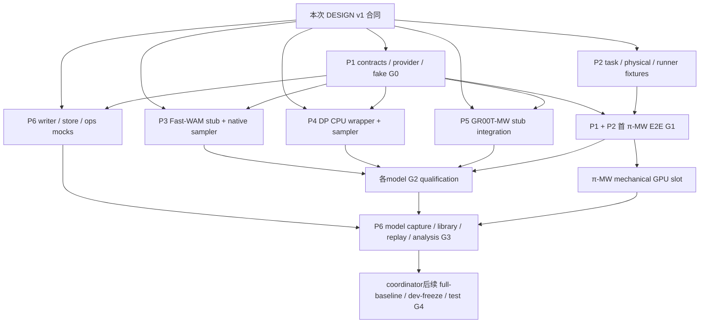

# R17 work packages：6 个并行 sol 实现包

这是后续实现的分工，不是本次已实现的功能。先读 [DESIGN.md](DESIGN.md) 中的接口/能力/gate和 [INVENTORY.md](INVENTORY.md) 的 F/M/B分类。owner要求沿现有framework接入；每个模型包提供hook，避免各写server/cache/conductor。[OWNER_NOTE.md:3](/home/weiland/projects/openpi/exp/r17_integration/OWNER_NOTE.md:3) [batching_core.py:3](/home/weiland/projects/openpi/src/openpi/serving/batching_core.py:3) [orchestrator.py:14](/home/weiland/projects/openpi/src/openpi/cache/orchestrator.py:14) [task.py:3](/home/weiland/projects/openpi/src/openpi/conductor/task.py:3)

**第一 end-to-end 验收目标：π0.5-MetaWorld。** P1+P2先通原formal H5/replan5协议，其余model包同时用已冻结v1contracts/fake框架开发；P6先用fakecapture做数据/工具。不等Fast/GR/DP训练完成再发现MW runner或bundle接口错误。π-MW已有trainconfig、wiretransform、runner，正适合隔离benchmark与model问题。[config.py:836](/home/weiland/projects/openpi/src/openpi/training/config.py:836) [metaworld_policy.py:55](/home/weiland/projects/openpi/src/openpi/policies/metaworld_policy.py:55) [episode_runner.py:106](/home/weiland/projects/openpi/exp/metaworld/episode_runner.py:106)

## 1. Ownership 与固定交付合同

建议各sol采用独立worktree/checkout实现；协调者统一合并，不写冻结R16/harness或正在训练的代码。每包只修改表中owned目录；需要sharedhook时通过文本接口请求交P1，不直接跨目录修改。最终实际实现默认off，今天设计审查零GPU、零进程操作。旧harness是frozen；R16只作为reference/legacyfixture。[README.md:3](/home/weiland/projects/openpi/exp/offline_search/harness/README.md:3) [ADAPTER.md:3](/home/weiland/projects/openpi/exp/offline_search/rounds/r16/ADAPTER.md:3)

| 包 | 归属重点 | 独占新目录 / 最小shared文件 | 必须交出的接口 / artifacts | 首次可工作时间 |
|---|---|---|---|---|
| P1 Shared framework + layout-aware五层 | F整合、M/B参数化 | `common/`, `tests/common/`；仅P1编辑shared `cache/{config,types,storage_types}.py`、`serving/websocket_policy_server.py`、需要的traceproviderregistry | ModelAdapter/BenchmarkSpec/FeatureSpec/Layout/Sampler/RequestRNG/Capabilities v1；providerregistry、connectionfactory、corelayers、FakeAdapter；legacy默认off证书 | 立即，先发布可import合同与fake |
| P2 MW benchmark / conductor / workers + π-MW | B整合 + 已支持π模型hook | `benchmarks/`, `conductor/`, `models/pi05/`, `tests/benchmarks/`, `tests/conductor/`, `tests/models/pi05/` | BenchmarkAdapter/EpisodeRunner/PhysicalAdapter；pi05adapter/provider；episodequeue/strategy；workerentry/probe；首π-MW E2E | 合同冻结后；任务/fixture/runner先独立做 |
| P3 Fast-WAM 两benchmarkadapter | M | `models/fastwam/`, `tests/models/fastwam/` | LIBERO/MWloader、nativeStages/KeyBuilder/StageBatcher/TraceAdapter、normidentity、nativeflowresume、servemanifest、samplefixture | 立即读vendor，按v1fakecontract实现 |
| P4 DP-T 两benchmarkadapter | M | `models/dp/`, `tests/models/dp/` | strictloader/stages/64keys、DDPM/DDIMprofiles、RNG/resume/capture、batcher、twonorminverse、servemanifest | 立即用E现有CPUwrapper；finalMWweight未就绪时用明确diagnostic |
| P5 GR00T-MW embodiment接入 | M | `models/groot/`, `tests/models/groot/` | onecamera/state4provider、wirepolicy、GRexistingstaged/cache复用、Kcompatendpoint、trace/batchhooks、librarygeometry | 立即用stubvendor/metadata；finalcheckpointimmutable后GPU资格 |
| P6 Library/debug/search/analysis/deployment qualification | F工具桥接 + M/B注入 | `debug/`, `search/`, `ops/`, `tests/debug/`, `tests/search/`, `tests/ops/`；共用顶层用户文档由协调者维护 | genericH5/NPZ→artifact/store、fit/replay/audit、modelcapturebridge、analysisprofiles、SHApayload/syncback、qualifiedrunbook和coverage矩阵 | 立即用fakefeatures/physicalcapture；与P2定义physicalschema |

上述新增目录均在 `exp/r17_integration/`。P2拥有nativeMWphysical**采集**和实体map，P6拥有shareddebug**writer桥接/运输/reader/analysis**；P3/P4/P5各拥有model-specificTraceAdapter，P6只消费其输出；P1拥有provider/trace registry和shared类型，不抢模型实现。所有包自己的测试独占目录，P6不能通过直接编辑模型包来修其shape。已有schema/核心重用依据：[SCHEMA.md:18](/home/weiland/projects/openpi/exp/offline_search/debug/SCHEMA.md:18) [adapter.py:61](/home/weiland/projects/openpi/exp/offline_search/debug/client/adapter.py:61) [runtime.py:255](/home/weiland/projects/openpi/src/openpi/cache/trace/runtime.py:255)

合同具体位置（拟议，P1创建）：`common/contracts.py`、`common/provider.py`、`common/serving.py`、`common/request_rng.py`、`common/query_view.py`、`common/layers/`；模型包导出 `register_provider()` / `load_adapter(spec)` / `make_connection_factory(...)` / `make_stage_batcher()` / `make_trace_adapter()`。所有imports必须CPU可执行、vendor/GPU只在显式load引入；GRbatchcore已有jax-free边界。[batching_core.py:25](/home/weiland/projects/openpi/src/openpi/serving/batching_core.py:25) [stage_io.py:29](/home/weiland/projects/openpi/src/openpi/serving/stage_io.py:29)

互传artifact合同：

- **ModelManifest v1**：immutableweights/base/delta/norm/tokenizer/code digests、feature/layout/sampler/capabilities、pythonisland、defaultK/H、allowedbenchmarkprotocols。
- **EpisodeManifest v1**：campaign/arm/YAML/bundle-generation/modelidentity/benchmarkprotocol/task-name/id/originalinitidx/taskdatahash/attempt/expectedcounts、fullreference与library/dev/test分区。
- **DecisionCapture v1**：实际nativefeatures/state、normalized/wireactions、source/cursor/executedcount、donor/weights/guard/knob、stagecalls/NFE/nativegrid/times、samplerreceipt、capabilitystatuses。
- **NativeSnapshot v1**：model/norm/layout/sampler/digest、loopindex、native_t、x_t、RNG/posteriornoise；同shape/dtype，resume identity严格。
- **VerificationReceipt v1**：test命令/exit/stdout、model/code/sourcehash、CPU/GPU、baselinepath、exact/rtoltolerance、skips/limits、GPUsmoke deadline/partialstatus。

以上是拟议新schema。与现有identity/attempt/status/payload合同相容；不能沿用A服务只用mtime的weightsidentity。[policy_identity.py:53](/home/weiland/projects/openpi/src/openpi/serving/policy_identity.py:53) [task.py:95](/home/weiland/projects/openpi/src/openpi/conductor/task.py:95) [SCHEMA.md:9](/home/weiland/projects/openpi/exp/offline_search/debug/SCHEMA.md:9) [storage_types.py:122](/home/weiland/projects/openpi/src/openpi/cache/storage_types.py:122) [serve.py:65](/home/weiland/projects/openpi/exp/mw_finetune/serve.py:65)

## 2. P1 — Shared framework与五层参数化

**Exact scope**：新增contracts/provider注册、minimaldefault-offsharedhooks，复用stockcache/backend/search/judge factories和WS控制；模型中立stagedconnectionpolicy；layout-awaremethodquery和一次性五层math实现；genericcapability/loadbundlevalidator；genericreplicaentrycommand计划（proxy原样复用）。不负责MWenv、vendorloader、数据采库、tetherdeploy，不改变旧R16入口限制。旧Plugin只支持两模型/旧horizon；新commonbridge消除限制，不能给Fast/DP伪造 `model="pi05"` 来骗过checks。[config.py:4384](/home/weiland/projects/openpi/src/openpi/cache/config.py:4384) [websocket_policy_server.py:782](/home/weiland/projects/openpi/src/openpi/serving/websocket_policy_server.py:782) [plugin.py:515](/home/weiland/projects/openpi/exp/offline_search/closed_loop/plugin.py:515) [serve_pi05.py:40](/home/weiland/projects/openpi/exp/offline_search/closed_loop/serve_pi05.py:40)

输入：DESIGNv1contracts + legacyrecipe源码 + 各模型metadata；输出：可importv1contracts、FakeAdapter、providerregistry与框架factory、layers/replayfixture及smallshareddiff。接口冻结后修订append-only或显式v2，不让4个模型包同时改签名。

Implementation checklist：

1. `common/contracts/provider/request_rng`，lazyregistry、不importmodelvendor；builtin旧路径不变。
2. optionaladapterbinding、新keybuilder/sampleridentity验证、artifactlayoutchecker；WS pre-registerbundlevalidator；默认none保持legacy。
3. `common/serving`沿originalstaged/orchestrator流程装配，保存perconnectionstate/readonlysharedfit，fullcall/helper和genericdebugtap。
4. `common/query_view/layers`动态realviews/PCA/state/action/gripper/taskN/H；legacy数字同路径；R10correctorlibrary-onlyLOEO、R11deterministicknob、tailcursoractualexecution。
5. nativeScheduleProvider/CachePayloadappend-only元信息，明确DDPM/fixedshiftedflow；warmreset/CP2/trace/routing各capabilityvalidated，继续原stock组合限制。

依据：[orchestrator.py:7](/home/weiland/projects/openpi/src/openpi/cache/orchestrator.py:7) [config.py:4392](/home/weiland/projects/openpi/src/openpi/cache/config.py:4392) [resident.py:20](/home/weiland/projects/openpi/exp/offline_search/rounds/r16/resident.py:20) [fitting.py:210](/home/weiland/projects/openpi/exp/offline_search/rounds/r10/recipe/fitting.py:210) [recipe.py:129](/home/weiland/projects/openpi/exp/offline_search/rounds/r11/knob/recipe.py:129) [config.py:3858](/home/weiland/projects/openpi/src/openpi/cache/config.py:3858)

**CPU acceptance**（必须有行为价值，不写只验证自己实现常量的tests）：

- 运行本次已通过的shared/conductor组合，且newoptionalhooks未注册时原metadata/acks/configvalidation/actions路径不变；existingoldartifact/positionalCachePayloadconstructor可读取。
- realWSloopback FakeAdapter：2clients/2bundlesinterleaveepisodes，mutablestate隔离；badYAML/unknownbundle/wrongcheckpoint/layout/samplers拒绝不破旧binding；sameID幂等、新ID重bind；断连结束session。
- stockBackend+CacheOrchestrator：CP1 FULL_HIT stagecounts(1,0,0)、MISS(1,1,K)、policy-tail(0,0,0)；实际normalized/wire只inverse一次；corrector/cursor/finiteerrorpaths。
- librarysyntheticfixture：双view7Dlegacy topk/tie/kernel/corrector/guard/periodic路径vs原recipe，输出相同；单view4D/task50/H5/16/32无需fakecamera/padding，无gripper修改，fitreads不碰query/outcome；LOEO排除整个donorepisode。
- RequestRNG跨顺序/threads/restart/replicas同semanticdecision同noise，varyarm/attempt不引入配对噪声差异；每DDPMstepnoise独立对应原stream。
- BatchingCorefake：bucketK/identity/shape/捕获分离、perrequestfaultisolation、replyevent完成、nooutputalias。

参考CPU接口证据：[test_router_bundle_rebind.py:1](/home/weiland/projects/openpi/tests/serving/test_router_bundle_rebind.py:1) [test_replica_proxy.py:1](/home/weiland/projects/openpi/tests/serving/test_replica_proxy.py:1) [conductor_replay.py:1](/home/weiland/projects/openpi/exp/offline_search/rounds/r16/conductor_replay.py:1) [test_conductor.py:1](/home/weiland/projects/openpi/exp/offline_search/rounds/r16/test_conductor.py:1)

**未来GPU smoke ≤15min / singleprocess**：0–3min加载已qualifiedπ；3–7min8fixedobsdefault/K2/K1 stagedvsfull，sameexplicitnoise；7–10min2clients两bundle交替HIT/MISS/tail+debugon/offbyteparity；10–13minB1/B2小batch与实际NFE；13–15minflush/verifyreceipt/正常关闭自有服务。若startup超3min，减少观测/episode，不超过deadline；未完成gate标partial，不自动重试无限延长。此测试不需要另起replicacopy；replicas在CPUproxytest先验。

依赖：P2πloader供真实probe；CPU合同/框架先于所有E2E，P1不等待新训练。

## 3. P2 — MW benchmark/conductor/debug采集与π第一目标

**Exact scope**：复用 `exp/metaworld/tasks/env/episode_runner/worker_entry/warm_reset_env` 与A的renderer/deployproof，新增MWBenchmarkSpec/adapter/nativephysicalcapture、R17conductorstrategy/globalqueue/census、workerentry，以及薄π-MWstagedadapter/provider。默认formalrun保留50×10、seed7、corner2、settle15、160controls/replan5；benchmark/library/devtestprotocol写newmanifest，不修改A正式合同。[tasks.py:25](/home/weiland/projects/openpi/exp/metaworld/tasks.py:25) [env.py:47](/home/weiland/projects/openpi/exp/metaworld/env.py:47) [episode_runner.py:106](/home/weiland/projects/openpi/exp/metaworld/episode_runner.py:106) [warm_reset_env.py:124](/home/weiland/projects/openpi/exp/metaworld/warm_reset_env.py:124) [CONTRACT.md:104](/home/weiland/projects/openpi/exp/mw_finetune/CONTRACT.md:104)

Ownedfiles：`benchmarks/{spec,metaworld,libero_bridge,physical_mt50}.py`、`conductor/{strategy,queue,driver,worker_entry,manifest}.py`、`models/pi05/{adapter,provider,serve}.py`。`libero_bridge`薄封装existingLiberoEpisodeRunner，不改旧sim。P6写ops不是P2；P6consume `PhysicalAdapter.capture()` 输出，P2不另写H5/NPZwriter。

必须接口：`BenchmarkAdapter.make_episode_runner(client_factory,capture_sink,execution_ack)`；workerprobe字段（packages/protocol/taskdata/camera/GL/settle/replan/maxsteps）；canonicaltaskname/taskidmap与episode-spec；πModelManifest、one-real-view32768KeyBuilder、4activechannels、H5。

CPU acceptance：

- canonical50unique/tasksdifficulty28/11/6/5、正式500exactids，Sept默认20绝不泄入正式；idx→sameMT1taskdatafixture，不将idx作resetseed；promptduplicate依然taskidentity独立。
- 原MWfakekernel与newrunner动作序列/obs帧/settle/success/cap逐步parity；中途success/truncation/exception正确标Result、episode_end、actualcontrols；wronginputshape/NaN拒绝。
- fakeWS两YAML跨episode切换与clientreuse、断连重建、未知bundle；P1runtime不接受A default-onlywrapper作为完整接入。
- 50tasksyntheticdescent queue：parallelpull least-busycompatibleendpoint、per-episodeattemptpersist、late/duplicateresult不计入cohort、firstfail终止、freezehash后test；n_dev20gate正确，不复制R16n30。
- nativeMujoco-model/data fake：qpos/qvel/object/contactforce无`.sim`依赖、float64capture、capabilitymissing列明确；server请求/control applied clip分别保存；MWgoal地图先对smoketask加cert，其余仍rawphysics且unsupportedgoalstatus。
- πoneviewkeyvsoriginalπpoolmath；MWnorm/4Dinverse、maskedwrists不进retrievallib；commit10/H5必须config拒绝，H5/replan1tail最多5和formalprotocol分开。
- `WorkerAgent/WorkerLoop`client-onlypayload在Python3.11可import，没有torch/JAX/vendor依赖；rendererlockfirst-render/closefakes验证。

依据：[test_env.py:28](/home/weiland/projects/openpi/tests/exp/metaworld/test_env.py:28) [test_runner.py:1](/home/weiland/projects/openpi/tests/exp/metaworld/test_runner.py:1) [test_workers.py:18](/home/weiland/projects/openpi/exp/mw_finetune/tests/test_workers.py:18) [worker.py:44](/home/weiland/projects/openpi/src/openpi/conductor/worker.py:44) [conductor.py:373](/home/weiland/projects/openpi/exp/offline_search/rounds/r16/conductor.py:373) [config.py:836](/home/weiland/projects/openpi/src/openpi/training/config.py:836)

**未来GPU+MW smoke ≤15min / 首完整链路**：

- 0–3min：只load immutableπ-MWserver，metadata/model/layout/normhash，full/k2/k1和tinysharedtoyfit bundles；不做GPU训练、不采正式库。
- 3–10min：timan107 **2workers**，`reach-v3 idx0/1`两机械episodes，同一个模型的full与retrieval/periodic bundleepisode间切；允许fake/syntheticlibrary但metadata明确，不报告质量SR。
- 10–12min：debugon/off固定obsparity、earlysuccess或截停执行cursor检查，phase断连/重投只作用自有workerreceipt。
- 12–15min：flushcloseddata、SHA回收、joinserver/client/journal、检查oneEpisodeTask/episode、N/V/M/K、image480/4D、真正H5commitbound，出mechanicalreport。

本smoke不能用toy库证明policy质量，也不要求完成formal500。EGL需workerGPU，但inferenceGPU空闲后才排期；今天P不运行。既有A机械π2episode0/2是接口证明而非质量，沿同口径。[HANDBACK_A.md:228](/home/weiland/projects/openpi/exp/mw_finetune/HANDBACK_A.md:228) [CONTRACT.md:124](/home/weiland/projects/openpi/exp/mw_finetune/CONTRACT.md:124)

Dependencies：P1G0 → P2πMW G1；P6writer早期用fake接口并行，真实采集/transport在P2G1接合。πH10candidate不阻塞core，独立结果标U/拒绝，不能为了交包擅改正式horizon。

## 4. P3 — Fast-WAM LIBERO + MetaWorld

**Exact scope**：publishedLIBEROloader（twoimages/state8/action7/H32/toggle）、C的MWbase+delta4Dloader、policy-ownedpre-DiTkeys、nativecutstages/flowK、normalization/wire、StageBatcher、trace/capture、warmresume/reset、model-specificofflineaugmentationloader和optionalCPUblueprint。ownWSentry只调用P1factory/sharedWS/core。不能改vendor、本轮C训练、或用C的4Dresetheadsloader加载LIBERO。[config.json:3](/data/mw_finetune/models/fastwam_libero/config.json:3) [config.json:42](/data/mw_finetune/models/fastwam_libero/config.json:42) [model.py:42](/home/weiland/projects/openpi/exp/mw_finetune/fastwam/model.py:42) [model.py:75](/home/weiland/projects/openpi/exp/mw_finetune/fastwam/model.py:75)

Exactfiles：`loader.py,staged.py,key_builder.py,batcher.py,wire_policy.py,trace.py,provider.py,serve.py,manifest.py`；所有在 `models/fastwam/`。P1供genericpolicy/controller；P6供store/analysis；P3交真实FeatureSpec/nativegrid和samplecapturefixture。

CPU acceptance：

- fixture载入LIBEROconfig保留7/8/twoimages/224×448与actionheads；MW4Ddelta严格参数匹配，immutablebase+Wan+delta+statsidentity；错误embodiment/missingtensors拒绝。
- originalprocessor/minmax/toggleVsnewwire；LIBEROgripper `sign(-(2*x-1))`exact，MW无toggle；samepreprocess/twoimages拼接顺序，缺view明确拒绝而非静默复制。
- stubVAE/pre_dit/video-prefill/actionexpert：HIT仅keyencode、MISS同stage1续prefill、nativeK次数准确；key来自video_pre tokens，可选fusedviewkey正确metadata，非外部CLIP。
- 显式传LeRobotconfig K10而非rawinfer默认K20；nativeFlowMatchSchedule真实CPUgrid：K1/2/10nativepoints/deltasreceipt；same-noisefullvsstaged数学updateparity；snapshot+suffixresume等完整loop，不uniformtime猜remainingsteps。
- B2stubs：vendororiginal `[0]`dropB问题在stagedbatch改掉，output/KV/noise不alias、feature/captureperrequest归属；不同shape/K/schedule分bucket。
- debugon/offnoextraRNGforward、tracevariantsmatchednoise；CP2key定义、warmreset/startnativepoints、capabilitiesfalse拒绝；CPublueprint无GPUtensors。

primarysource：[configuration_fastwam.py:216](/data/mw_finetune/vendor/lerobot/src/lerobot/policies/fastwam/configuration_fastwam.py:216) [modular.py:1799](/data/mw_finetune/vendor/lerobot/src/lerobot/policies/fastwam/wan/modular.py:1799) [processor_fastwam.py:43](/data/mw_finetune/vendor/lerobot/src/lerobot/policies/fastwam/processor_fastwam.py:43) [modeling_fastwam.py:401](/data/mw_finetune/vendor/lerobot/src/lerobot/policies/fastwam/modeling_fastwam.py:401) [modular.py:1810](/data/mw_finetune/vendor/lerobot/src/lerobot/policies/fastwam/wan/modular.py:1810) [modular.py:1879](/data/mw_finetune/vendor/lerobot/src/lerobot/policies/fastwam/wan/modular.py:1879) [modular.py:1902](/data/mw_finetune/vendor/lerobot/src/lerobot/policies/fastwam/wan/modular.py:1902)

**未来GPU smoke ≤15min / 一次一个checkpoint**：0–4minload/3warm；4–8min3fixedobservations samecpu seed full/staged+K1/2、keyshape/fusedviewmask，Ckey/prefill/head breakdown；8–11mintwo-connections/two-bundles forcedHIT/MISS/tail10；11–13min一个短MWreachepisode **或** 一个LIBEROspatialepisode；13–15mintraceclosed/snapshotresume/receipt。两benchmark分别排≤15minslot，绝不同时load两checkpoint。大型load超预算留partial，nativeG1/G2资格按未完成项标未验证。B2内存不够时明确停止B2cert，不宣称vectorbatch已qualified。

Deliverables：LIBERO/MW分离manifest、adapter代码、CPUtestreport、GPUready命令（declaredisland，nowdonotrun）、unknownfeaturecost ledger、futurecheckpointqualitylimits；fusedpre-DiTkey质量由P6后续offlinepairedstudy，不拿timing代替质量。

Dependencies：仅依赖P1contracts/factory；MWmechanical依赖P2benchmark；libraryfit/trace读出依赖P6。训练中先用immutableexistingcheckpointdiagnostic，finalcheckpointdescriptor由coordinator提供。

## 5. P4 — DP-T LIBERO + MetaWorld

**Exact scope**：按Ewrapper严格重用重建的475tensorarchitecture、ownconditionkey、DDPM100和reducedgrid、可选explicitDDIM、internal+external两norm、RNGsuffixresume/nativeadd_noise reset、batcher、trace/capability/provider与serveentry。不能把strictload证据变成“作者originalwrapper完全复现”，不能把ML45zerowrist诊断当finalMT50quality。[RECIPE.md:35](/home/weiland/projects/openpi/exp/mw_finetune/dp/RECIPE.md:35) [RECIPE.md:60](/home/weiland/projects/openpi/exp/mw_finetune/dp/RECIPE.md:60) [HANDBACK_E.md:15](/home/weiland/projects/openpi/exp/mw_finetune/dp/HANDBACK_E.md:15) [HANDBACK_E.md:25](/home/weiland/projects/openpi/exp/mw_finetune/dp/HANDBACK_E.md:25)

Exactfiles与P3同命名风格，另 `sampler.py,request_noise.py,normalization.py`；都在 `models/dp/`。与E接口：只importloader/model/config，支持immutableEexport，不修改Etraining；E目前serve_compat存在，完整R17adapter另入口不依赖monkeypatchAregistry。[HANDBACK_E.md:59](/home/weiland/projects/openpi/exp/mw_finetune/dp/HANDBACK_E.md:59)

CPU acceptance：

- 小CPUcheckpointprobe strict475weights，defaultK100full/stagedsameobs/sameseedparity；若耗时过长先用小toy结构pytest，完整一次CPUprobe给单独有deadline报告；不触GPU。
- 真policyvisualencoder输出ReLU64 per-realviewkey；MWzero secondbranch保留languageconditioning，在changedprompt时notconstant；languagecache/taskidentity/hash、resize/crop/normalizersexact。
- `sample`normalized切点在internalinverse之前；to_wireinternalinverse+externalquantileinverse各一次，LIBEROraw7、MW4，finite16×dims；two-stats-mismatch failfast。
- DDPMScheduler realCPUgrid K1/2/100与Egridmatch，actualNFE；DDIMprofile单列eta/grid/prediction/varianceidentity；不得用100stepgrid截两步。
- DDPMperrequestposteriornoise与initialnoise deterministicstreams，单请求vsB2/异步/反向requestorder/parity；resume保存x_t+index+generatorstate或noise suffix后与uninterruptedexact；wrongnativepoint/scheduler/normsnapshot拒绝。
- fakeWSbundlesK100/2/1、HIT/MISS、tail10/15、episode隔离；stagedencoder只一次；noextraRPC/modelcalldebugparity；CaptureSpec可生成nativeinteger-ttrace/libraryfixture。
- warmreset用scheduler.add_noise，flowshoot配置明确not_applicable且不能默用flowimplementation；CP2/onlineRITnativefirstupdate标清sampler semantics；splitCPUblueprint不夹带vendor/GPU对象。

primarysource：[model.py:77](/home/weiland/projects/openpi/exp/mw_finetune/dp/model.py:77) [model.py:134](/home/weiland/projects/openpi/exp/mw_finetune/dp/model.py:134) [model.py:154](/home/weiland/projects/openpi/exp/mw_finetune/dp/model.py:154) [policy.py:53](/home/weiland/projects/openpi/exp/mw_finetune/dp/policy.py:53) [HANDBACK_E.md:49](/home/weiland/projects/openpi/exp/mw_finetune/dp/HANDBACK_E.md:49)

**未来GPU smoke ≤15min / 单checkpoint**：0–3minload；3–7min3observationsK100/2/1 vsEwrapperfull、ownkey/normalization/cost；7–10minB1/B2samplerstream及nativewarmresume；10–13minoneMWreach或oneLIBEROspatial机械episode，two-bundleepisodeboundary切；13–15mindebug/H5closed/receipt。default100steps若压缩机械时长，减少观测，不改变defaultbaselineK冒充full。LIBERO/MW分开两个slot；原0/2LIBERO和1/16ML45smallsmoke不当SRacceptance门槛。[HANDBACK_E.md:22](/home/weiland/projects/openpi/exp/mw_finetune/dp/HANDBACK_E.md:22)

Deliverables：releasewrapperprovenance、allidentity/norm/samplerprofile、CPUparity/noisemappingreport、librarycapturefixture、lowstep质量U清单、GPUready命令。依赖P1；MWepisodeP2，P6store/analysis接fixture。finalMT50training未ready时tagdiagnostic不formal发布。

## 6. P5 — GR00T N1.5-MW

**Exact scope**：复用samevendor `GrootStagedRunner/GrootCacheInterceptor/GrootStageBatcher` 和B的MWloader/DataConfig，新增MWfactory/wire、one-cameraCP1/CP2geometry、stateactive4/action4H16、K4/2/1endpointcompat、trace/capture/nativewarmresetprovider/librarymanifest。LIBERO既有能力只做defaultoffregression，不复制/修改frozenR16。[staged.py:263](/home/weiland/projects/openpi/src/openpi/cache/groot/staged.py:263) [interceptor.py:126](/home/weiland/projects/openpi/src/openpi/cache/groot/interceptor.py:126) [batcher.py:240](/home/weiland/projects/openpi/src/openpi/cache/groot/batcher.py:240) [policy.py:32](/home/weiland/projects/openpi/exp/mw_finetune/groot/policy.py:32)

Exactfiles：`loader.py,key_builder.py,wire_policy.py,provider.py,serve.py,trace.py,manifest.py`；可有thinbatcher wrapper，**不新写Eagle网络**。需改变sharedGroot类时给P1接口请求及failingCPUfixture，不跨目录改。

CPU acceptance：

- stubGr00tPolicy/APIshape沿B conventions，metadata metaworld_sawyer/slot31检查、state4/videoimage/wire16×4；拒绝LIBEROstats/7actions/8state/wrongembodiment。
- `GrootStagedRunner`vendorhashguards保留，stubsamefeature/LLM/head vsupstreamdefaultfull；onecameraimage_token_mask slice+state_mask，pool16/realvisionfields，缺tokenrun尺寸拒绝；不启`verify_upstream=False`掩vendordrift。
- originalapply/unapplytransforms仅一次，无LIBEROgripperinversion；CP1HITskipbackbone/head，MISSK与liveK4/2/1严格匹配；sameprocess不写globalK。
- concurrenttwo-bundlefactoriesperconnectionmemos/runner/keybuilder独立，sharedbackend/model；H16tail10/15actualcursor，warmstartschedule/liveK binding；wronglibrarygeometrystats拒绝。
- S3batchertracevariants沿已有bucket，各requestshape/noise/schedule/semantics；S1/S2当前不batch显式capabilities，不把stubloop声称fullbatch；newidentity/provider跟P1hotload连通。
- trace/librarytrueonecamera、DP/Fast genericreader可同样消费；warmupnormdump共享机制；CP2/onlineRIT optional hooks用state4，不偷用LIBEROternarymetadata。

primarysource：[conventions.py:6](/home/weiland/projects/openpi/exp/mw_finetune/groot/conventions.py:6) [conventions.py:23](/home/weiland/projects/openpi/exp/mw_finetune/groot/conventions.py:23) [staged.py:317](/home/weiland/projects/openpi/src/openpi/cache/groot/staged.py:317) [key_builder.py:79](/home/weiland/projects/openpi/src/openpi/cache/groot/key_builder.py:79) [interceptor.py:248](/home/weiland/projects/openpi/src/openpi/cache/groot/interceptor.py:248) [batcher.py:291](/home/weiland/projects/openpi/src/openpi/cache/groot/batcher.py:291)

**未来GPU smoke ≤15min / 单checkpointK**：0–3minloadfinalimmutableMWcheckpoint（training未结束不启动）；3–6min2fixedobs unsplit/stagedsameexplicitnoise、实际image_masktokenrun/active4、Ckey/LLM/head；6–10mintwo-client/two-YAML、forcedHIT/MISS/tail10、debugon/off；10–13minoneMWreach机械episode+nativewarmresume；13–15minflushclosed/receipt。K4/2/1可在15min内串行切ownedprocess（需先释放内存）；如加载占太多时间，分为每K≤15minslots并标K未验证，不能in-placeconcurrentmutatehead赶时间。

Dependencies：P1factory/contracts，P2MWrunner，P6artifactbuilder；B最终checkpoint由coordinator提供。已有GRMWmidtraining14/16仅H，不代替本接口qualification。[RESULTS.md:14](/home/weiland/projects/openpi/exp/mw_finetune/RESULTS.md:14)

## 7. P6 — Debug/library/offline/analysis/deploy闭环

**Exact scope**：把全部模型/benchmarkhooks接到现有采集格式和offline/tooling，genericartifact/storebuilder、library-onlyfit调用、replay/audit、decision/physicalprofiles、SHAcodebundle/syncback、futureGPUqualificationops；不是训练、不是最终500episode实验。复用sharedDataCollector/H5sink/PerStepRecorder/osdebugwriter/transport，保留nativegrid；oldmemmap/harness不改，newversionedstore记录dynamicfeatures/H/actiondims/realviews。[data_collector.py:100](/home/weiland/projects/openpi/src/openpi/collect/data_collector.py:100) [h5_sink.py:1](/home/weiland/projects/openpi/src/openpi/cache/trace/h5_sink.py:1) [per_step_recorder.py:1](/home/weiland/projects/openpi/src/openpi/serving/per_step_recorder.py:1) [build_library_store.py:3](/home/weiland/projects/openpi/exp/offline_search/r0/build_library_store.py:3) [README.md:3](/home/weiland/projects/openpi/exp/offline_search/harness/README.md:3)

Exactfiles：`debug/{capture_bridge,reader_profiles,analysis_profiles,validate}.py`、`search/{store,build_library,fit,replay,analyze,freeze,audit}.py`、`ops/{plan,build_client_bundle,deploy,serve_registry,sync_back,smoke}.py`。P1创建layers/fitmath，P6调用并写artifact/shape/provenance封装；P2提供nativephysicalmap/capture；模型包提供staged/capture/schedule，不做互相monkeypatch。

必须交付：

1. dynamicgeometryH5/NPZ→stockbackendartifact和versionedmemmapstore，READYmanifest+sourcehash，partial保留可审计；nativewarm/RNG字段完整，不伪装legacyπschema。
2. teacherlibrary、factorwarmup、GPUnetworkwarmup三种recipes分开；nestedlibrary/dev/testmanifest按DESIGN新split；只有≥3episodes/task的fit可开LOEOcorrector，smallsize声明不支持该layer。
3. genericoffline`fit/reset/query` bridge、LOEOdonorexclusion、replaybothstandalone/resident、多clientdebugbitparity、modelmetadata与acceptedepisodejoin；case-by-case实验质量与timing分离。
4. defaultreport包括SR/缺失/errors/pertask/difficulty/equalgroup、stagecalls/NFE/NVM/commit、absolute和within-modelnormalized成本、source/library/fit/protocolhash、bootstrappairedidentity；debugcards/physics工具status完整，missingsemantics无假truth。
5. isolated3.11clientpayload、SHA attestation、EGLlockreuse、tether lane/exit75boundedretry/freeportreservation/ownedreceipts、remotejournalfsyncsafeSHA snapshot；future ≤15minsmokecommand带deadline、GPUglobal排期、normalstop自有service/worker；不碰trainingprocess。
6. Cosmos-LIBERO optional bridge spec（独立protocol→normalWS+benchmarkwrapper，仅MVP可独立排后续），decoupleCPUblueprint/Unixpath资格计划；当前Cosmos-MW unusable、splitadvancedrestrictions保持status，不声称已全面支持。

依据：[warmup_pool.py:1](/home/weiland/projects/openpi/src/openpi/cache/warmup_pool.py:1) [fitting.py:66](/home/weiland/projects/openpi/exp/offline_search/rounds/r10/recipe/fitting.py:66) [SCHEMA.md:164](/home/weiland/projects/openpi/exp/offline_search/debug/SCHEMA.md:164) [CONTRACT.md:91](/home/weiland/projects/openpi/exp/mw_finetune/CONTRACT.md:91) [CONTRACT.md:116](/home/weiland/projects/openpi/exp/mw_finetune/CONTRACT.md:116) [runtime.py:13](/home/weiland/projects/openpi/exp/mw_finetune/runtime.py:13) [serve_cosmos.py:11](/home/weiland/projects/openpi/exp/cosmos_nfe/serve_cosmos.py:11) [split_runtime.py:211](/home/weiland/projects/openpi_decouple/src/openpi/serving/split_runtime.py:211)

CPU acceptance：

- fourfakeModelSpecs × LIBERO/MWfixture roundtrip：H5/NPZ/keys/action/state/nativegrid保存loadexact，不同identity/layout/camera/schedule artifact拒绝；atomicclosed/partial/tornJSONL恢复，checksumtamper拒绝，无pickleNPZ。
- capturetap不用π/GRhardcodedbranch；fakeforward/RNGcountsdebugon/off相同，tail无vision/modelcalls；droppedblocks、unsupportedcamera/taskpredicate写明status，不把缺记录当0成本。
- genericlibrarybuilder activechannels、nestedepisodes/successpolicy、prev/next/taskdatahash/LOEO、防fitqueryread；defaultartifactloader legacy/新meta兼容，不读/archive。
- offline/resident/WSfakereplay同data同seed动作+guard/knob/topk/cost相同，freeze之后YAML/model/norm/layout/sampler/fit任一变更failaudit；error/lateattempt不入formalcount。
- physics/decisionreportsfixture产生HTML/PNG/CSV/JSON，onecameraDP64/Fastfused/π32768、MWtask50/channel3gripper/workercapture；missingpredicate/truth字段保留unsupported。
- SHAclientpayloadPython3.11import不需要modelislands；tetherretry/portselection/ownedstop全mock；snapshot同run重复安装idempotent、busyjournal拒绝、tamper拒绝；noGPUtensorCPUblueprint/短Unixsocketpath test。

参考existingtests：[test_workers.py:46](/home/weiland/projects/openpi/exp/mw_finetune/tests/test_workers.py:46) [test_server_parity.py:1](/home/weiland/projects/openpi/exp/offline_search/debug/tests/test_server_parity.py:1) [README.md:44](/home/weiland/projects/openpi/exp/offline_search/debug/tools/physical/README.md:44) [README.md:35](/home/weiland/projects/openpi/exp/offline_search/debug/tools/decision/README.md:35)

**未来GPUsmoke ≤15min**：0–3minreuse一个空闲已qualifiedπ-MWmodelprocess；3–8min2机械episode onefull+oneretrieval、writer/livecapture/actualcursor；8–11min对已保存1–2observations离线policyshadow/nativewarmvariant（明确额外GPUcost）；11–13minH5→tinyartifact→reloadbundle+forcedHIT；13–15minSHA syncback、completejoin/analysisreport，闭合后正常关闭自有process。无完整library/devdescent/500eval，batch吞吐/replicas/split全量是另行qualification，不挤进该slot。

Dependencies：contracts先于实现但fake可立即；P2physicalhook/schema + 各modelcapturefixture即可接；实际G3证书在modelG2之后。P6负责总coverage表，每一INVENTORY ID标 `reuse tested / hook implemented / GPU qualified / not_applicable reason / pending owner`，不能只有happy-path截图。

## 8. Ordering / dependencies / readiness

具体顺序：

1. **立即并行**：P1types/fake/provider；P2canonicaltask/protocol/physicalfixtures；P3readvendor/norm/nativegrid；P4trueCPUstaged/RNG；P5GRstubMWfactory；P6capture/store/opsfake。任何sharedinterface变更由P1publish一次。
2. **接口对齐关口**：共同跑fakeAdapterconformance。P1发布binding/configschema/featurelayout/sampler snapshot方法；模型包无需等待完整五层fit工具，可以先full/K/CP1HIT/MISS。
3. **先π-MW**：P1+P2+P6writer交叉CPUloopback→唯一首GPUslot（GPU训练结束、coordinator排期后）→firstend-to-endhandback。πH5commit的限制如实记录，独立replan1实验不冒充formal协议。
4. **模型并行接合**：P3/P4/P5分别出CPUmanifests+capturefixture，同suite/benchmarkwireconformance；GPUslots**串行**，每次一模型，一份checkpoint，一包≤15min，每slot退出清ownedreceipt。
5. **工具完整和最终策略**：P6G3audit；coordinator准备immutablefinal模型/fullbaseline、library/dev/test和pricing，随后全量实验；G4非smallsmoke验收。R16历史reference不改，不在未完成frozen新test时先看formaltestsuccess调参数。

此顺序将framework/benchmark不确定性最先清掉，同时模型包天然独立；保留旧机制的依据：[task.py:1](/home/weiland/projects/openpi/src/openpi/conductor/task.py:1) [conductor.py:304](/home/weiland/projects/openpi/exp/offline_search/rounds/r16/conductor.py:304) [websocket_policy_server.py:600](/home/weiland/projects/openpi/src/openpi/serving/websocket_policy_server.py:600) [orchestrator.py:7](/home/weiland/projects/openpi/src/openpi/cache/orchestrator.py:7)

## 9. 交包格式、总验收与 remaining work

每个sol handback至少含：ownedfiles及actualdiff、interface版本、defaultoff证书、CPU命令/exit/真实pass与skip、model/benchmark-specifichook表、nativegrid/norm/feature/storage样例、GPUready≤15min命令但明确未执行/执行receipt、knownlimits和每一pending项owner。小CPUchecks可直接运行；GPUcommand今天只写，不排队占trainingGPU，也不把历史sharedGPU授权当当前允许。现有A合同会要求GPUlock，当前本任务更严格为零GPU。[CONTRACT.md:124](/home/weiland/projects/openpi/exp/mw_finetune/CONTRACT.md:124)

| 总门槛 | 完成证据 | 主责 |
|---|---|---|
| G0 framework conformance | 默认legacy路径不变，fakebundles/CP1/NFE/isolations、CPUcontracts、minshareddiff | P1；所有模型包consume |
| G1 first π-MW | sameformalbenchmark、oneownkey/4D/H5、full/K、five-layers与debug/conductor/libraries/replay、bundle轮换；commitbound有真实声明 | P2 + P1，P6writer |
| G2 newmodelconformance | LIBERO/MW分别stagevsfull、norm/sampleridentity、key与费用sample、K/commit、concurrent/bundle/batch+replica支持范围、mechanicalGPUreceipt | P3 / P4 / P5 |
| G3 全功能support | nativewarmcontinue/reset、trace/library/warmup/augmentation、offline/search/analysis/transport/ops、capability-by-ID合格；不适用专项理由可审计 | P6 + 各hookowner |
| G4 可比较的质量/成本实验 | finalimmutablecheckpoint、baselinefull500、library/dev/test/seeds密封、pricing/pairedSRbootstrap、error/missing/renderer统计 | coordinator后续全量实验 |

不能用 `concurrent=True`、default-onlybundle、只过infer smoke来交“系统已接入”。也不能为承诺“一切都支持”伪造πH5的10step tail、把DPsampler称flow、把GRconnectionthread称stagebatch、把Cosmos独立protocol称完整cache支持。源码已确认这些边界；workpackages负责正确补hook并完成证书。[serve.py:143](/home/weiland/projects/openpi/exp/mw_finetune/serve.py:143) [config.py:836](/home/weiland/projects/openpi/src/openpi/training/config.py:836) [model.py:134](/home/weiland/projects/openpi/exp/mw_finetune/dp/model.py:134) [batcher.py:291](/home/weiland/projects/openpi/src/openpi/cache/groot/batcher.py:291) [serve_cosmos.py:11](/home/weiland/projects/openpi/exp/cosmos_nfe/serve_cosmos.py:11)

本次P已完成的CPU审查结果见 [verification/CPU_CHECKS.md](verification/CPU_CHECKS.md)；以上新包验收测试均是后续实现清单，不虚报已通过。未验证的模型GPU成本/数值、finalcheckpoint质量、MWphysicalgoal/restore、完整trace+resident组合和newmodelsplit都在对应包中有owner，完整清单见 DESIGN §11。
